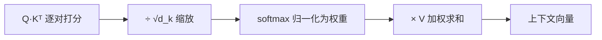

> 上一章结尾留了一个悬念:token embedding 只是「查表」,与顺序无关,「猫追狗」和「狗追猫」在表里长得一模一样——词与词之间必须有一种机制,让它们**按需互相交流信息**。这个机制就是本章的主角:注意力(Attention)。它也是 2017 年之后几乎所有大模型的「地基中的地基」:理解了它,Transformer(06 章)就只剩拼装。

**学习目标**:学完本章,你将能够——

1. 用自己的话定义注意力机制,并解释「查询—键—值」三个角色各是什么;
2. 说出它解决了循环神经网络(RNN)的哪三大痛点,为什么说它是「对 RNN 的替代而非补丁」;
3. 手写并拆解缩放点积注意力公式,解释 `√d_k` 为什么必不可少;
4. 区分自注意力、交叉注意力与因果(掩码)注意力三种形态及各自用途;
5. 解释多头注意力为什么有用,以及注意力 `O(n²)` 复杂度带来的工程约束。

## 1. 概念:注意力机制是什么

- **注意力机制(Attention Mechanism)**是神经网络中的一个组件:计算某个位置的输出时,它**动态地为输入序列中每个位置分配一个权重**,再把这些位置的向量按权重加权求和,得到携带全句信息的「上下文向量」。
- 关键在于两个词:**动态**(权重不是写死的,而是随输入内容实时算出)与**加权求和**(每个输入都参与,只是贡献大小不同)。
- 一句话骨架:**注意力 = 可学习的加权平均**。给谁更多权重,不是人定的,而是模型在训练中从数据里学出来的。

### 1.1 三个生活化类比

| 类比 | 对应关系 |
|---|---|
| 考试做题 | 读完题(查询)后,在草稿/笔记(键)里找相关内容,把重点(值)抄进答案 |
| 图书馆检索 | 你带着问题(Query)去查目录(Key),命中后取出书的内容(Value) |
| 人读长句 | 眼睛不会平均扫过每个字,而是聚焦关键处,视线分配随理解动态变化 |

- 共同点:**手里有一堆信息,但「此刻该用哪部分」取决于当下的问题**——注意力就是把「此刻的问题」和「候选信息」做匹配,再按匹配度提取信息。

### 1.2 查询—键—值:注意力的「三件套」

- 借用信息检索的术语,注意力把每个 token 同时扮演三个角色:

| 角色 | 英文 | 类比 | 作用 |
|---|---|---|---|
| 查询 | Query(Q) | 你提出的问题 | 决定「我在找什么」 |
| 键 | Key(K) | 资料的标签/标题 | 决定「这段内容是什么」 |
| 值 | Value(V) | 资料正文 | 真正被提取走的内容 |

- **匹配**发生在 Q 与 K 之间(算相似度),**提取**发生在权重与 V 之间(加权求和)。K 与 V 通常一一对应:先按 Q-K 相似度决定「取多少」,再按 V 决定「取到什么」。
- 历史坐标:注意力最早于 2014 年由 Bahdanau 等人在神经机器翻译中提出——让解码器在生成每个词时「回看」编码器的全部隐状态并分配权重,实现译文与源文的软对齐[2];2017 年 Vaswani 等人在《Attention Is All You Need》中把它从 RNN 的「配件」升级为纯注意力架构(Transformer)的核心[1]。

## 2. 为什么需要它:循环模型的三座大山

- 2017 年之前,处理序列(文本、语音)的主流是**循环神经网络(RNN)**:逐词读入,把历史压缩进一个「隐状态」向后传递。注意力正是为了推翻 RNN 的三个结构性缺陷而生:

### 2.1 长程依赖:越远越记不住

- RNN 的信息要沿着时间步**一步一步传**才能到达远处的词。每传一步都要经过非线性压缩,梯度会随距离指数级衰减或爆炸(03 章讲过梯度消失)——所以 RNN 对「隔了 50 个词的主语和谓语」几乎无能为力。
- **注意力的解法:一步直达。** 任意两个 token 之间直接算相关性,距离不再是障碍——「隔得远」与「挨得近」在注意力眼里没有区别。

### 2.2 定长向量瓶颈:一句话压成一个点

- 经典 seq2seq 翻译模型把整句源文编码成一个**固定长度向量**,再交给解码器。句子越长,单靠一个向量能带走的信息越不够——论文原话:这个「定长向量是性能的瓶颈(bottleneck)」[2]。
- **注意力的解法:信息留在原地。** 不再强求压缩,编码器每个位置的隐状态都保留,解码器按需「回看取用」。

### 2.3 顺序计算:一个词等一个词

- RNN 处理第 t 个词必须等前 t-1 个词算完,天然无法并行,训练长文本极其缓慢。
- **注意力的解法:全序列一次性算。** 注意力只依赖「两两配对」,可以写成矩阵运算,GPU 一次性并行完成——这也是 Transformer 能吃掉海量数据的前提。

### 2.4 三种序列建模方式对比

| 对比项 | RNN(递归) | CNN(卷积) | 注意力 |
|---|---|---|---|
| 关联距离 | 随距离衰减 | 受卷积核窗口限制 | **与距离无关,一步直达** |
| 并行性 | 差(逐时间步) | 好 | **好(矩阵化)** |
| 信息瓶颈 | 隐状态 | 无 | **无(全量保留)** |
| 建模成本 | 线性 | 线性 | **平方级(见 4.4)** |

## 3. 它有什么作用:从「孤立词」到「语境词」

- 嵌入只给了每个 token 一个**静态坐标**(04 章);注意力让每个 token 的输出变成**带着全句信息的动态表示**:

1. **消歧义**:「他打开**苹果**电脑写代码」中的「苹果」,经注意力聚合后向量里混入了「电脑」「代码」的信息,自然偏向「品牌」而非「水果」;
2. **指代与搭配**:「小明说小红迟到了,**她**很抱歉」——「她」的表示要靠注意力抓到「小红」;
3. **对齐与可解释性**:翻译场景中注意力权重能画出「哪个源词对应哪个译词」的热力图,最早就是为对齐而生;它还能当诊断工具(注意:权重高**不等于**因果解释,只能作为线索);
4. **并行与端到端**:全部操作可微、可并行,能随整个模型用反向传播联合训练;
5. **与检索同构**:回想 04 章的向量检索——Q 与 K 算相似度、按相似度取 V,本质上就是「软检索」。RAG 是硬性取 Top-K,注意力是软的加权取全部,思想同源。

- **工程价值一句话**:注意力是 LLM 的「关系引擎」——没有它,模型只会背诵孤立的词;有了它,模型才能「阅读理解」。

## 4. 详细介绍:四个必懂的技术点

### 4.1 缩放点积注意力公式

$$ \text{Attention}(Q, K, V) = \text{softmax}\left(\frac{QK^\top}{\sqrt{d_k}}\right) V $$

- 其中 Q、K、V 是矩阵(每行一个 token 的查询/键/值向量),`d_k` 是键向量的维度。整条流水线分四步:

1. **打分**:`QKᵀ` 逐对计算查询与键的点积——点积越大,方向越一致,「这个问题越匹配这段内容」;
2. **缩放**:除以 `√d_k`,防止分数失控(下面解释);
3. **归一化**:对每一行做 softmax,让权重非负且和为 1,变成「概率式」的注意力分配;
4. **汇总**:用权重对各位置的 V 加权求和,得到该 token 的新表示。

- **为什么必须除以 `√d_k`?** 若 q、k 各分量均值为 0、方差为 1,则点积的方差 ≈ `d_k`——维度越大,分数方差越大,softmax 越容易进入饱和区(一个分数独大、其余趋近 0),梯度趋近于零,模型训不动。除以 `√d_k` 把方差拉回 1,softmax 保持「敏感」[1]。
- **为什么打分用点积而不是别的?** 点积在 GPU 上有高度优化的矩阵乘法实现,且数学性质好;论文实验表明加性注意力在小维度下相近,但点积更快、省显存[1]。

### 4.2 三种注意力形态

| 形态 | Q 来自 | K、V 来自 | 典型用途 |
|---|---|---|---|
| **自注意力**(self-attention) | 本序列 | 本序列 | 句内词与词互相关联,如「她」找「小红」 |
| **交叉注意力**(cross-attention) | 一侧序列(如解码器) | 另一侧序列(如编码器输出) | 翻译/摘要:生成时去「读」源文 |
| **因果(掩码)注意力**(masked/causal) | 本序列 | 本序列,但只允许看当前位置及之前 | 语言模型逐词生成,不许偷看未来 |

- 实现细节:因果注意力不需要改算法,只需在打分矩阵上把「未来位置」的分数设为 `-∞`,softmax 后权重自然为 0——这个掩码技巧在 07 章语言建模中会再次出现。

### 4.3 多头注意力:一个注意力不够,就开八个

$$ \text{MultiHead}(Q,K,V) = \text{Concat}(\text{head}_1, \dots, \text{head}_h) W^O,\quad \text{head}_i = \text{Attention}(QW_i^Q, KW_i^K, VW_i^V) $$

- **为什么要多头?** 单次注意力只能学出一种「相关性定义」。而真实文本里同时存在多种关系:指代、主谓一致、修辞修饰、句法邻近……多头给每头配一组独立的投影矩阵 `W_i`,让它们**在各自子空间里并行学不同的关系**,最后拼起来再过一层输出投影 `W^O`。
- 类比:同一段材料,让语法学家、侦探、编辑各读一遍,每人带回一份不同角度的笔记,汇总成完整理解。
- **参数不增**:若模型维度 `d_model = 512`、头数 `h = 8`,每头只分到 `d_k = d_v = 64` 维;8 个头拼回 512 维,总参数量与单头 512 维注意力**完全一致**——多头是「花同样的钱,买 8 种视角」。

### 4.4 复杂度与工程现实:平方级的代价

- 注意力要对**每一对** token 打分,时间与显存复杂度都是 `O(n²)`(n 为序列长度)。n = 8192 时约有 6700 万对组合。
- 这解释了 04 章留下的问题:**上下文窗口为什么是有限且昂贵的**——窗口翻倍,注意力开销翻四倍。长上下文模型卖得贵,很大程度贵在这里。
- 主流的缓解路线(了解即可,细节在 06/09 章展开):
  - **FlashAttention**:不改变数学结果,通过 IO 感知的分块计算把显存占用从 `O(n²)` 降到 `O(n)`,速度大幅提升,今天的模型几乎都在用;
  - **稀疏/滑动窗口注意力**:只让每个 token 关注局部邻域加少数全局 token(如 Mistral 等模型);
  - **推理期的 KV Cache**:生成第 t 个词时,前 t-1 个词的 K、V 已算过,缓存复用避免重复计算——这是 LLM 推理延迟的主要优化点(09 章)。

## 5. 总结

### 5.1 本章一览

| 概念 | 一句话 |
|---|---|
| 注意力机制 | 动态分配权重的加权平均;可学习的「软检索」 |
| 为什么需要 | 解 RNN 三难:长程依赖、定长瓶颈、无法并行 |
| Q / K / V | 查询负责「找什么」,键负责「是什么」,值负责「给什么」 |
| 缩放点积公式 | `softmax(QKᵀ/√d_k)·V`;`√d_k` 防 softmax 饱和、保梯度 |
| 三种形态 | 自注意力(句内)、交叉注意力(两侧)、因果注意力(不许看未来) |
| 多头 | 多个子空间并行学不同关系,参数不增、视角增多 |
| 复杂度 | `O(n²)`,决定窗口上限;FlashAttention / 稀疏注意力 / KV Cache 是解法 |

### 5.2 思考题

1. 为什么说注意力是「软检索」?它和 04 章的 RAG「硬检索」有什么异同?
2. 若去掉公式里的 `√d_k`,当 `d_k = 512` 时点积分数的方差约多大?softmax 会变成什么样,对训练有何影响?
3. 「猫追狗」与「狗追猫」:仅靠注意力能区分它们吗?还需要什么?(提示:回看 04 章 4.5 节)
4. 生成文本时为什么必须用因果注意力?如果允许模型「偷看」后面的词,会发生什么?
5. 为什么说「多头」没有增加总参数量?若 `d_model = 4096、h = 32`,每头的维度是多少?

> [!note] 参考答案
> 1. 相同点:都是「问题向量与候选向量算相似度、按相似度取内容」;不同点:RAG 取 Top-K 硬选、结果喂进提示词;注意力对全部候选加权、软选,权重可微可训练。
> 2. 方差约 512,标准差约 22.6;分数相差巨大,softmax 输出接近 one-hot,对非最大项梯度几乎为 0,训练停滞。
> 3. 不能。注意力只建立「谁和谁相关」,本身不带顺序概念;必须配合位置编码注入先后信息,再谈「谁追谁」(06 章)。
> 4. 生成是逐词自回归的:当前词只能依赖已生成的词,训练时必须用掩码模拟同一条件,否则模型学到「作弊」,推理时行为失配。
> 5. 多头把总维度切成 h 份并行处理再拼接,总参数量不变;每头维度 = 4096 ÷ 32 = 128。

## 引用

- [Vaswani et al., *Attention Is All You Need*, NeurIPS 2017(arXiv:1706.03762)](https://arxiv.org/abs/1706.03762)
- [Bahdanau et al., *Neural Machine Translation by Jointly Learning to Align and Translate*, ICLR 2015(arXiv:1409.0473)](https://arxiv.org/abs/1409.0473)
- [Jay Alammar:The Illustrated Transformer(注意力可视化讲解)](https://jalammar.github.io/illustrated-transformer/)
- [动手学深度学习:注意力机制章节(中文)](https://zh-v2.d2l.ai/chapter_attention-mechanisms/index.html)

上一篇:[Token 与 Embedding](/iopanda-blog/ai/01-models/01/04/)——嵌入给了每个 token 孤立的坐标,注意力在此之上建立词与词的关系。

下一篇:[Transformer 架构](/iopanda-blog/ai/01-models/01/06/)——注意力是核心零件;下一章看它如何被拼成自注意力层、多头与整个 Transformer。
