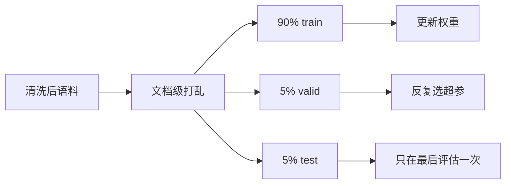

> 上一章把语料洗干净,这一章决定它们「往哪儿去」:多少给模型背、多少留给自己看、多少锁进保险柜留作最终考试,以及多个来源的语料按什么比例混在一起。读完你要能回答三个问题:**训练/验证/测试三集各管什么?为什么测试集一次都不能用来调参?为什么多来源语料不能按原始大小直接拼接?** 最后亲手产出一份可复现的切分报告。

**学习目标**:学完本章,你将能够——

1. 说清训练集、验证集、测试集的不同职责,并解释为什么用测试集调参会让最终分数失真;
2. 使用固定随机种子完成 90%/5%/5% 的文档级切分,并验证重复运行结果一致;
3. 识别「内容泄漏」与「时间泄漏」两类风险,并说出各自的规避方法;
4. 解释数据混合(data mixture)的概念,以及为什么不能按各来源原始大小直接拼接;
5. 为多来源语料制定明确的采样比例,连同 seed 与文件 hash 一起写入配置与报告。

## 1. 数据切分:一份语料,三个互不重叠的去向

- **概念**:数据切分(dataset split)就是把清洗后的语料,按**文档/段落**为单位,划分成三个互不重叠的子集:训练集、验证集、测试集。上一章的去重决定了「留哪些文本」,本章决定「这些文本分别给谁用」。
- **为什么预训练必须切分**:预训练的目标是让模型学会语言规律,而不是背下语料。一个会背的模型在训练文本上 loss 可以趋近于 0,但碰到没见过的文本照样乱猜——所以只看训练损失,永远无法判断模型是否真的学会了。评估必须使用**训练时没见过的文本**,切分就是为评估准备「干净的新题」。

| 集合 | 谁在看 | 用途 | 允许改什么 |
|---|---|---|---|
| 训练集 train | 优化器 | 更新权重,让 loss 下降 | 权重本身 |
| 验证集 valid | 开发者,可反复看 | 选超参数、判断何时停训、比较结构 | 学习率、层数、上下文长度、混合比例等一切超参数 |
| 测试集 test | 只在最后看一次 | 给「模型面对全新数据」的最终证据 | 什么都不许改 |

### 1.1 为什么测试集一次都不能用来调参

- 测试集存在的唯一意义,是充当**「没见过的新数据」的无偏样本**——它是你对泛化能力最诚实的一次估计。这份诚实只存在于「从未影响过任何决定」的前提下。
- 污染机制:假设你看到测试 loss 偏高,于是调低学习率、再测、再调……每一轮「看一个数 → 改一个决定」,都把测试集的信息写进了模型选择。几轮之后,测试集实际上变成了验证集:模型是**在测试集上被选出来的**,最终分数必然虚高,上线后面对真新数据立刻回落。这称为**测试集污染(test set contamination)**。
- 类比考试:训练=做练习册;验证=平时测验,可以看错题、调整复习计划;测试=期末考,考完才公布成绩。如果考前就偷看期末卷并据此复习,分数就再也说明不了真实水平。
- 因此纪律是:**测试集只在全部调参结束后运行一次**。一旦它影响过任何决定,它就降级为验证集,必须重新隔离一份从未看过的测试集。

### 1.2 为什么文本不能按 token 随机切分

- 表格数据可以按行随机抽 90/10;文本不行——语言数据有结构:一篇文章的相邻段落主题连贯、用词相关,把它们随机分进 train 和 valid,验证就退化成「记忆检测」:模型只要记住上一段的措辞,就能「预测」下一段。
- Mini GPT 的实践:**以文档或章节为切分单元**,而不是 token 或句子。
- 若语料是单一长文(如整本书),则使用**不重叠的连续区间**切分,并在报告中说明局限:全书风格统一,valid 与 train 再小心也可能高度相似。



## 2. 两种泄漏:让验证分数「虚高」的元凶

- **概念**:数据泄漏(data leakage)指训练信息以非预期方式进入了评估集,模型在评估时「见过」数据,分数虚高,而真实部署时不会重现。第 1 节的全部纪律,本质上都是为防泄漏。文本语料要特别提防下面两种。

### 2.1 内容泄漏:切分不重叠 ≠ 文本不重复

- 切分只能保证**索引**不重叠,不能保证**文本**不重复:同一篇文章可能以转载、改写等不同形式同时出现在两个集合里。上一章虽已去重,切分后仍应再做一次**跨集合内容 hash 校验**(第 4 节动手),确认任意两份的 hash 集合交集为空。

### 2.2 时间泄漏:不能让模型「见过未来」

- 若来源带时间信息(新闻日期、Reddit 时间戳、GitHub commit 时间),把较晚的数据放进训练、较早的数据放进验证,等于让模型「见过未来」——此时评估的是回忆,不是对新数据的预测。
- 正确做法是**按时间切分**:用较早数据训练、用较晚数据验证/测试,以模拟真实部署时「未来数据」的样子。
- 这不是教学洁癖:大规模模型中广泛讨论的**基准污染**(评测题文本混进训练爬虫语料),正是公开榜单分数与真实体验不符的已知原因之一。

## 3. 数据混合:为什么不能按原始大小直接拼接

- **概念**:数据混合(data mixture)指把多个来源(网页通用文本、书籍、代码、数学、多语言……)按**显式设定的比例**合并成训练流,并决定每个来源被采样多少轮。切分解决「数据怎么分」,混合解决「不同来源怎么配」。
- **为什么不能按原始大小拼接**:真实语料来源极不均衡——网页爬虫数据以 TB 计,代码和高质量书籍只有 GB 级。若把各来源原样拼成一个大文件再均匀采样,每个 batch 几乎全是网页文本,模型练满全程也见不到几次代码,「大来源淹没小来源」。
- 数值直觉:来源 A 有 900 GB 网页文本,来源 B 只有 10 GB 代码。按原始大小拼接后均匀采样,平均每 91 个 token 里只有 1 个来自代码。想让模型真正具备 10% 的代码能力,必须对代码来源**过采样**(重复多轮),同时给网页来源降权。
- 工业界例证:一是 The Pile(EleutherAI,2020),825 GiB、22 个子集,是最早把每个子集配比与来源一起公开的语料之一;二是 Llama 3(Meta,2024),最终混合约为 **50% 通用知识、25% 数学与推理、17% 代码、8% 多语言 token**——这个比例不是按来源大小推出来的,而是先用知识分类器给网页数据分类、再靠小模型缩放定律实验(scaling law)试出来的。可见**混合比例本质上是超参数**,值得用实验对待。
- 教学项目不必做缩放实验,直接采用显式方案起步即可,例如:

| 来源 | 按原始大小的占比 | 目标混合比例 | 手段 |
|---|---|---|---|
| 通用中文文本 | 约 95% | 70% | 降采样 |
| 代码 | 约 4% | 20% | 过采样(重复) |
| 指令格式文本 | 约 1% | 10% | 过采样(重复) |

- 混合改变的是采样比例,**不改变来源的出处与合规责任**:每个来源仍必须保留自己的许可与清洗记录(第 02、03 章)。
- **验证/测试集不要按训练混合比例「补齐」**:train 决定「喂什么」,valid/test 决定「考什么」——它们应代表你想检验的使用情景。例如模型主要服务中文说明书续写,valid 里就应有独立的中文说明书,而不是按训练配比混出来的短英文句子。

| 检查项 | 合格条件 |
|---|---|
| 可复现 | 保存 seed、切分规则与文件 hash |
| 无泄漏 | 训练与验证/测试无重复文档 |
| 代表性 | 验证集覆盖常见与边界样本 |
| 可解释 | 混合比例与选择理由写入配置 |

## 4. 动手活动:完成一次文档级切分

下面假设上一章清洗产出的 `data/processed/documents.txt` 每一行是一篇完整段落。脚本先用**稳定的随机源**打乱文档,再切出三个互不重叠的列表。创建 `src/split_data.py`,复制完整内容;实践中把随机种子、输入文件 hash、比例以及本次输出 hash 一起写入报告。

```python
import random
from hashlib import sha256
from pathlib import Path

seed = 42
documents = [line for line in Path("data/processed/documents.txt").read_text(encoding="utf-8").splitlines() if line]
rng = random.Random(seed)
rng.shuffle(documents)

total = len(documents)
train_end = int(total * 0.90)
valid_end = train_end + int(total * 0.05)
splits = {
    "train": documents[:train_end],
    "valid": documents[train_end:valid_end],
    "test": documents[valid_end:],
}
for name, rows in splits.items():
    output = Path(f"data/processed/{name}.txt")
    output.write_text("\n".join(rows) + "\n", encoding="utf-8")
    digest = sha256(output.read_bytes()).hexdigest()
    print(name, len(rows), digest)
```

运行并验证三份数据互不重叠:

```bash
python src/split_data.py
python -c "from pathlib import Path; a=set(Path('data/processed/train.txt').read_text().splitlines()); b=set(Path('data/processed/valid.txt').read_text().splitlines()); c=set(Path('data/processed/test.txt').read_text().splitlines()); print(len(a & b), len(a & c), len(b & c))"
```

最后一行必须是 `0 0 0`。将三份 split 的数量和 hash 写到 `reports/split-report.md`;再运行一次脚本,hash 应完全一致。若不一致,检查是否固定了 `seed`、输入文件是否被手工改过。

- **更进一步(内容级校验)**:上面的代码只能证明索引不重叠,不能证明文本本身不重复。对每个文档标准化后计算 hash,检查任意两个 split 的 hash 集合交集为空。
- **更进一步(时间切分)**:若来源含日期,优先用较早数据训练、较晚数据验证/测试,模拟真实的未来数据(见 2.2)。

> [!example] 动手活动:生成可复现切分
>
> **目标**:输出 `train.txt`、`valid.txt`、`test.txt` 与 `split-report.md`。
>
> **步骤**:固定随机种子;按文档或段落切分 90%/5%/5%;计算每份的样本数、字符数和 hash;检查交集;将 seed 和比例写入 `configs/data.yaml`。
>
> **完成标准**:重复运行后文件 hash 不变;报告显示任意两份数据没有重复样本。

| 现象 | 先执行 | 通常原因 |
|---|---|---|
| 重跑后 hash 变了 | 对比输入文件 hash | 未固定 seed,或输入文件被手工改动 |
| 交集不是 `0 0 0` | 检查切分单元 | 同一文档的相邻段落被随机分到两个集合,或语料本身有重复行(需先完成第 03 章去重) |
| valid 只有几十行、loss 抖动 | 打印三份长度 | 语料太小,5% 过少;可提高验证比例或改用分层切分 |
| 测试集被拿来调参了 | 重留一份测试集 | 纪律问题:旧测试集改称 valid,重新隔离一份从未看过的测试集 |

## 5. 总结

| 产物 | 用途 |
|---|---|
| `train/valid/test.txt` | 三个互不重叠、可复现的数据去向 |
| `reports/split-report.md` | 记录 seed、比例、数量与 hash,让切分可审计 |
| `configs/data.yaml` | 固化混合比例与选择理由,让配置可解释 |

验证集用于过程决策,测试集用于最终证据。数据切分一旦确定,除非发现真实错误,不应为了提高分数而随意调整。

**思考题**:为什么同一篇文章的相邻段落不应随机分到 train 和 valid?若测试集被看过一次并据此调整了学习率,应该如何处理?某来源的原始数据量是另一来源的 100 倍,直接按原始大小拼接训练,模型最可能在哪方面变差?为什么?

> [!note] 参考答案
> 1. 相邻段落通常内容高度相似,会使验证变成记忆检测——模型记住前一段就等于「会做」后一段,验证分数失去意义。
> 2. 该测试集已经参与决策,不再是「从未见过的数据」;应将它改称验证集,并重新隔离一份从未查看的测试集作为最终证据。
> 3. 大来源会淹没小来源:每个 batch 几乎全部来自大来源,小来源领域(如代码、数学)样本太少,模型几乎学不到,该领域能力明显偏弱;应显式设定混合比例,并对小来源过采样。

## 引用

- [scikit-learn:train_test_split 的随机状态与分层概念](https://scikit-learn.org/stable/modules/generated/sklearn.model_selection.train_test_split.html)
- [Google ML Crash Course:过拟合与泛化](https://developers.google.com/machine-learning/crash-course/overfitting/regularization)
- [The Pile:825 GiB、22 子集的公开混合语料](https://pile.eleuther.ai/)
- [Llama 3 Herd of Models(数据混合 50/25/17/8)](https://arxiv.org/abs/2407.21783)

上一篇:[数据清洗与去重](/iopanda-blog/ai/01-models/02/03/)——清洗后的文本需要被划分为互不泄漏的训练与评估数据。

下一篇:[训练分词器](/iopanda-blog/ai/01-models/02/05/)——数据边界确定后,将文本转换为模型可处理的 token。
