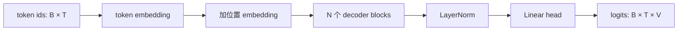

> 上一章 [构建数据管道](/ai/01-models/02/06/) 把文本变成了成批的输入与下一词标签;本章把数据喂进模型:亲手实现一个教学规模的 decoder-only Transformer。动手前先弄清三件事——它是什么、为什么注意力必须遮住未来、残差连接与 LayerNorm 在深层网络里各起什么作用;最后用形状检查和「未来扰动测试」证明它真的只会利用过去的信息。

**学习目标**:学完本章,你将能够——

1. 画出 Mini GPT 从 token id 到词表 logits 的数据流,并说明它为什么没有 encoder;
2. 解释自注意力为什么必须遮住未来,以及 mask 为什么要在 softmax 之前施加;
3. 说明残差连接与 LayerNorm 各自解决什么问题,缺少它们会发生什么;
4. 实现带因果 mask 的多头自注意力、Transformer Block 与 MiniGPT 组合;
5. 对模型输出形状和「不能偷看未来」做最小验证,判断训练前代码是否正确。

## 1. 解码器 Transformer:概念与模型边界

- **概念**:解码器 Transformer(Decoder-only Transformer)是一种只保留「解码器」的自回归架构:输入是前面的 token 序列,输出是每个位置对「下一个 token 是谁」的未归一化打分。它没有独立的编码器,也没有交叉注意力——全部注意力都发生在输入序列内部(自注意力),因此推理时能一个 token 接一个 token 地自己续写。
- **为什么预训练语言模型几乎都选它**:

| 理由      | 说明                                                                                     |
| ------- | -------------------------------------------------------------------------------------- |
| 目标天然匹配  | 预训练任务是「根据前文预测下一个 token」;decoder-only 每个位置的输出正好对应一个预测,架构与目标一一对应,无需为 encoder 另设计掩码语言模型目标 |
| 训练与生成同构 | 训练时模型「看着过去预测未来」,生成时它也「只看着自己刚写出的过去」,两者结构一致,不存在错位                                        |
| 生态最成熟   | GPT 系列与主流开源模型(Llama、Mistral、Qwen 等)均为 decoder-only,加速库与工程经验可直接复用                       |

- **取舍**:本章实现的是「会预测下一个 token」的基础模型部分;它还不是聊天产品——要变成好用的助手,还需要 01.03 单元的指令微调与偏好对齐。

核心数据流如下:



其中 `B` 是 batch size、`T` 是 context length、`V` 是词表大小。`logits` 是未归一化分数,不是 token id:训练时交给交叉熵计算损失,生成时才转换为概率并抽样(第 9 章)。

推荐初始配置:`vocab_size=2000`、`context_length=128`、`d_model=128`、`n_heads=4`、`n_layers=4`。必须满足 `d_model % n_heads == 0`,整除才能把每个 token 的 `d_model` 维表示均分为 `n_heads` 份,每份 `head_dim = d_model / n_heads` 维。

## 2. 注意力为何必须遮住未来

### 2.1 自注意力在做什么

自注意力先计算位置间的相似度:`QKᵀ / √d_head` 得到分数矩阵,用 softmax 归一成权重,再对 `V` 加权求和。简单说,每个位置「向序列中所有位置打听信息,并按相关性汇总」——这种互通是**双向**的:位置 3 既能看位置 1,也能看位置 10。对需要理解全文的 encoder 这正合适,但对「预测下一个 token」的语言模型,却是致命的。

### 2.2 为什么必须「只准看过去」

语言模型在位置 3 预测下一个词时,不能读取位置 4 及以后,否则训练损失会虚假地很低,生成时却没有未来 token 可读。展开说有三个原因:

1. **目标会退化成复读**。位置 3 的任务是预测位置 4;如果它能看到位置 4 的 token,最优策略就是直接抄答案——损失可以压到接近 0,但模型什么都没学会,一旦生成(未来不存在)就立即原形毕露。
2. **训练与生成不对称**。训练时整段文本都在,未来「确实存在」;生成时未来还没有产生。若训练允许偷看,模型学到的「能力」在推理时根本无法复现,这是最隐蔽的 train/serve 错位:验证损失漂亮,生成却是一团乱码。
3. **删 labels 救不了**。labels 只是计算损失时的正确答案,删掉它只让「该位置不算损失」;输入序列中的未来 token 依然会通过注意力把信息传给早期位置,泄漏照样发生。

> [!important] 如果不遮未来会怎样
> loss 会异常地低(接近直接复制),验证集 loss 同样低得可疑——一切看起来「训练成功」,实际是模型在作弊。因此因果性不是锦上添花的正确性检查,而是训练能否开始的先决条件,必须在训前用 4.1 节的最小测试证明。

### 2.3 因果 mask 的正确实现

因果 mask 是下三角矩阵:允许位置 `i` 看 `j ≤ i`;被遮住的位置在 softmax **之前**填充为负无穷:

```python
mask = torch.tril(torch.ones(T, T, dtype=torch.bool, device=x.device))
scores = scores.masked_fill(~mask, float("-inf"))
weights = torch.softmax(scores, dim=-1)
```

被遮位置经 softmax 后权重为 0(`exp(-inf) == 0`),可见位置的权重仍归一化、总和为 1。两个易错点:

- 不要在 softmax **之后**再把权重置零:剩余权重不再和为 1,输出被不成比例地缩小,破坏概率解释;
- 把 mask 注册为 buffer(`register_buffer`),它就能随 `.to(device)` 一起移动,且不会被优化器当作参数更新。

## 3. 残差连接与 LayerNorm:让网络深得起来

### 3.1 LayerNorm:稳住每个 token 的表示尺度

- **概念**:LayerNorm 对**每个 token** 在通道维(`d_model`)上计算均值与方差,把表示归一化成零均值、单位方差,再乘可学习的缩放 `γ` 与偏移 `β`。它与 batch 无关,天然适配变长序列和单样本推理(不必像 BatchNorm 那样依赖 batch 统计)。
- **为什么需要**:Transformer 有几十上百层,激活值的尺度会随层数逐层漂移、方差被不断放大。注意力里的 softmax 对输入尺度极敏感,尺度漂移会让训练发散或震荡。
- **如果不做会怎样**:深层网络的数值尺度失控,学习率几乎无法选择——调大一点就发散,调小一点就几乎不学;浅层能跑的配置,加深几层就崩。

### 3.2 残差连接:给梯度一条「高速公路」

- **概念**:残差连接把子层的输出加回输入,写成 `x + 子层(变换(x))`。它让每个 Block 只负责学习「相对输入的增量」,而不是从零刻画整个映射。
- **为什么需要**:反向传播时梯度要穿过所有层连乘,层数一深,梯度指数级消失或爆炸,深层参数几乎得不到更新。残差提供了恒等捷径:无论网络多深,`∂x / ∂x` 这一项保证梯度至少有一条不衰减的路径直接回传,深层网络才训得动。
- **如果不做会怎样**:去掉残差的深层 Transformer 梯度消失、难以收敛,模型实际表达能力退化成「浅层网络」——这也是 2016 年 ResNet 之后所有深层架构都标配残差的原因。

### 3.3 组合成 Block:先归一、再变换、后相加

现代语言模型普遍采用 pre-norm 布局(先 `norm` 再进子层,残差加在子层输出上),梯度路径最干净。在 `src/model.py` 中先实现以下最小版本;该版本故意不使用 flash attention,目的是让每一步的 shape 可见:

```python
import math
import torch
from torch import nn

"""
因果（自回归）多头注意力。
---
每个位置只能「看到」自己和它之前的位置，看不到未来 —— 这是 GPT 类模型能够逐 token 生成的前提：预测第 t 个 token 时不能泄露第 t+1 个 token 的信息。
"""
class CausalSelfAttention(nn.Module):

	"""
	初始化注意力层的参数与因果掩码。
	---
	Args:
		d_model: 隐藏层维度，即每个 token 的向量长度。
		d_heads: 注意力头数，d_model 必须能被它整除。
		context_length: 最大上下文长度，决定因果掩码矩阵的大小。
	"""
    def __init__(self, d_model: int, n_heads: int, context_length: int):
        super().__init__()
        
        # 多头是把 d_model 均分给每个头，除不尽说明配置非法，直接快速失败。
        assert d_model % n_heads == 0
        self.n_heads = n_heads
        
        # 单个头的维度，用于后面的注意力收缩
        self.head_dim = d_model // n_heads
        
        # 一次线性变换同时算出 Q、K、V（输出 3 倍维度后再切分）。
        # 相比三个独立的 Linear，合并成一次矩阵乘法能更充分地利用 GPU 的算力。
        self.qkv = nn.Linear(d_model, 3 * d_model)
        
        # 输出投影：把各头拼接后的结果再混合一次，让不同头之间的信息可以交互。
        self.proj = nn.Linear(d_model, d_model)
        
        # 下三角布尔矩阵：tril 的第 i 行第 j 列为 True，表示「位置 i 允许关注位置 j」。
        # 注册为 buffer 而非 Parameter，因为它不需要梯度更新，但会随 model.to(device) 一起被搬到 GPU，省去手动搬运。
        self.register_buffer("mask", torch.tril(torch.ones(context_length, context_length, dtype=torch.bool)))

	"""
	前向计算
	---
	Args:
		x: 形状 (batch, steps, channels)，其中 channels 即 d_model。
	Return:
		与输入同形状的张量 (batch, steps, channels)。
	"""
    def forward(self, x: torch.Tensor) -> torch.Tensor:
    
	    # batch: 批量大小
	    # steps: 当前序列长度
	    # channels: 隐藏维度 d_model
        batch, steps, channels = x.shape
        
        # 一次投影得到 Q/K/V，再沿最后一维平均切成三份
        q, k, v = self.qkv(x).chunk(3, dim=-1)
        
        """
        把 (batch, steps, d_model) 拆成 (batch, n_heads, steps, head_dim)。
        先把最后一维拆成 (n_heads, head_dim) 两部分，再把「头」这一维交换到前面。这样每个头就变成独立的 (steps, head_dim) 矩阵，可交给批量矩阵乘法统一处理。
        """
        def split_heads(t):
            return t.view(batch, steps, self.n_heads, self.head_dim).transpose(1, 2)
        
        
        q, k, v = map(split_heads, (q, k, v))
        
        # 缩放点积注意力：Q 与 K 的转置相乘，得到任意两个位置之间的相关性分数。
		# 除以 sqrt(head_dim) 是为了防止维度增大时点积方差过大，把 softmax 推入饱和区
		# 导致梯度过小；这一步是「Scaled」Dot-Product Attention 中 Scaled 的含义。
        scores = q @ k.transpose(-2, -1) / math.sqrt(self.head_dim)
        
        # 因果掩码：把「未来」位置（mask 为 False 的上三角区域）的分数置为 -inf，
		# 经 softmax 后这些位置的权重恰好为 0，等价于被完全屏蔽。
		# 只取前 steps×steps 是为了兼容短于 context_length 的输入。
        scores = scores.masked_fill(~self.mask[:steps, :steps], float("-inf"))
        
        # 沿 key 维度（最后一维）做 softmax，得到每个位置对所有可见位置的注意力权重（和为 1）
        weights = torch.softmax(scores, dim=-1)
        
        # 用注意力权重对 V 加权求和，得到每个位置融合上下文后的输出
        out = weights @ v
        
        # 还原形状：把「头」这一维换回中间位置，再合并回 (batch, steps, d_model)。
		# transpose 之后内存不再连续，必须先 contiguous() 才能安全地 view。
        out = out.transpose(1, 2).contiguous().view(batch, steps, channels)
        
        # 最后过一层输出投影，混合各个头的信息
        return self.proj(out)


"""
一个 Transformer 残差块：注意力子层 + 前馈子层。
采用 Pre-Norm 结构（先归一化，再送入子层），相比原始 Transformer 的 Post-Norm
训练更稳定，因此被 GPT-2 及之后的模型普遍采用。
"""
class Block(nn.Module):

	"""
	初始化两个子层以及它们各自的前置归一化。
	---
	Args:
		d_model: 隐藏层维度。
		n_heads: 注意力头数。
		context_length: 最大上下文长度。
		mlp_ratio: 前馈网络中间层的升维倍数，默认 4。
	"""
    def __init__(self, d_model, n_heads, context_length, mlp_ratio=4):
        super().__init__()
        self.norm1 = nn.LayerNorm(d_model) # 注意力子层之前的归一化
        self.attn = CausalSelfAttention(d_model, n_heads, context_length)
        self.norm2 = nn.LayerNorm(d_model) # 前馈子层之前的归一化
        # 前馈网络：先升维 mlp_ratio 倍以提供足够的非线性表达能力，再降回 d_model。
		# GELU 比 ReLU 更平滑，是 GPT 系列的默认激活函数。
        self.mlp = nn.Sequential(nn.Linear(d_model, mlp_ratio * d_model), nn.GELU(), nn.Linear(mlp_ratio * d_model, d_model))
    
	"""
	前向计算：两个子层各自带一条残差连接。
	---
	Args:
		x: 形状 (batch, steps, d_model)。
	Returns:
		与输入同形状的张量 (batch, steps, d_model)。
	"""
    def forward(self, x):
        x = x + self.attn(self.norm1(x)) # 残差连接 x + 子层输出：让梯度可以沿捷径直通底层，是深层网络能够训练的关键
        return x + self.mlp(self.norm2(x))
```

初始化阶段不必先理解所有数学推导,但必须理解两件事:其一,每个 Block 的输入输出形状始终是 `[B, T, d_model]`——残差要求前后形状一致,这是设计上不变式;其二,MLP 把每个 token 独立地「想得更深」,注意力负责跨位置交换信息,两者分工不同、缺一不可。

## 4. 组合 MiniGPT 并验证因果性

- **概念**:`token_embedding` 把 token id 查表成可学习向量;`position_embedding` 给每个位置一个可学习向量——没有它,模型无法区分「猫吃鱼」和「鱼吃猫」(常见误区见第 5 节);`head` 把最后的表示投影回词表大小。
- **验证逻辑**:模型是输入的确定性函数。若因果 mask 正确,改动第 `T` 个(未来)token,前 `T-1` 个位置的 logits 必须纹丝不动;若它们变了,说明未来信息泄漏进了注意力。

```python
"""
最小可用的 GPT 语言模型。
结构：词嵌入 + 可学习位置嵌入 -> N × (注意力 + 前馈) -> LayerNorm -> 线性输出头。
"""
class MiniGPT(nn.Module):
	"""
	初始化模型的各个组件。
	---
	Args:
		vocab_size: 词表大小，决定输入 id 的取值范围与输出 logits 的维度。
		context_length: 最大上下文长度。
		d_model: 隐藏层维度。
		n_heads: 每层注意力的头数。
		n_layers: Transformer Block 的堆叠层数。
	"""
    def __init__(self, vocab_size, context_length, d_model=128, n_heads=4, n_layers=4):
        super().__init__()
        self.context_length = context_length
        
        # 词嵌入：token id -> d_model 维向量
        self.token_embedding = nn.Embedding(vocab_size, d_model)
        
        # 位置嵌入：位置 id -> d_model 维向量。注意力机制本身对顺序不敏感，
		# 必须额外注入位置信息；这里使用可学习的位置表，长度固定为 context_length。
		# 也正因如此，输入长度超过 context_length 会索引越界，forward 中做了显式校验。
        self.position_embedding = nn.Embedding(context_length, d_model)
        
        # 把 n_layers 个结构相同的 Block 串成顺序容器
        self.blocks = nn.Sequential(*[Block(d_model, n_heads, context_length) for _ in range(n_layers)])
        
        # 输出前的最终归一化（Pre-Norm 架构的收尾步骤）
        self.norm = nn.LayerNorm(d_model)
        
        # 语言模型头：d_model -> vocab_size，输出每个位置对全词表的分数。
		# bias=False 是 GPT-2 的做法；GPT-2 还会让它与词嵌入共享权重，本项目未做共享。
        self.head = nn.Linear(d_model, vocab_size, bias=False)
    
    """
    前向计算，返回每个位置对全词表的未归一化分数（logits）。
    ---
	Args:
		ids: 形状 (batch, steps) 的 token id 张量。
	Returns:
		形状 (batch, steps, vocab_size) 的 logits。
	---
	注意：此处刻意不做 softmax —— 训练时交给 CrossEntropyLoss（其内部含 log_softmax，数值更稳定）；推理时若需要概率，再手动调用 softmax 即可。
	"""
    def forward(self, ids):
        _, steps = ids.shape # 只需要序列长度；batch 维交给后续广播自动对齐
        
        # 位置嵌入表的长度就是 context_length，越界会触发难以定位的索引错误，
		# 因此提前抛出语义清晰的异常
        if steps > self.context_length:
            raise ValueError("输入超过 context_length")
        
        # 位置 id 为 0, 1, ..., steps-1；device 跟随输入，避免 CPU / GPU 张量相加时报错
        positions = torch.arange(steps, device=ids.device)
        
        # 词嵌入与位置嵌入逐元素相加，广播成 (batch, steps, d_model)，得到输入表示
        x = self.token_embedding(ids) + self.position_embedding(positions)
        
        # 依次经过全部 Block、最终归一化、输出头，得到 logits
        return self.head(self.norm(self.blocks(x)))
```

先用随机合法 id 检查 `model(ids).shape == (B, T, vocab_size)`。再复制一份输入,只改最后一个 token;在 `model.eval()` 且关闭 dropout 的条件下,前 `T-1` 个位置 logits 应保持相同——这是 mask 的直接验收:早期位置不应受未来 token 影响。

### 4.1 将两段代码保存并实际运行

将本章第 3、4 节两段代码按顺序放入同一个 `src/model.py` 文件;文件开头保留 `import math`、`import torch`、`from torch import nn`。然后在文件末尾加入下列 smoke test(它不是训练,只验证网络接线):

```python
if __name__ == "__main__":
	# 固定随机种子，保证每次运行的结果可复现
    torch.manual_seed(42)
    model = MiniGPT(vocab_size=2000, context_length=128)
    
    # 构造一个 (batch=2, steps=8) 的随机输入
    ids = torch.randint(0, 2000, (2, 8))
    
    # 复制一份，并且只改动「第一个样本的最后一个 token」，其余位置保持完全一致
    changed = ids.clone()
    changed[0, -1] = (changed[0, -1] + 1) % 2000
    
    # 切换到推理模式（关闭 dropout 等训练期行为；本模型虽无 dropout，但属良好习惯）
    model.eval()
    
    # 两次前向：两批输入仅最后一个 token 不同
    first = model(ids)
    second = model(changed)
    print("logits shape:", first.shape)
    
    # 因果性检查：由于每个位置只能看到自己和之前的位置，改动最后一个 token
	# 不应影响前面任何位置的输出，因此该最大差值应为 0（浮点误差下可能极小）。
	# 若明显不为 0，说明掩码失效，模型在训练时会「偷看」未来答案。
    print("earlier-position max difference:", (first[:, :-1] - second[:, :-1]).abs().max().item())
    
    # 打印可训练参数总量，便于对照模型规模
    print("parameters:", sum(p.numel() for p in model.parameters()))
```

运行 `python src/model.py`。预期 shape 是 `torch.Size([2, 8, 2000])`,前七个位置差异为 `0.0`(极少数设备可能显示约 `1e-7` 的浮点误差)。若差异明显大于 `1e-6`,不要开始训练:优先检查 `masked_fill` 是否在 softmax 前执行、mask 是否使用 `[:steps, :steps]`。

> [!example] 动手活动 1:实现并验收 Mini GPT 前向传播
>
> **目标**:完成 `src/model.py` 与 `reports/model-smoke-test.md`。
>
> **步骤**:1)实现注意力、Block、MiniGPT;2)用来自上一章的一个 batch 前向运行;3)记录参数量和 logits shape;4)执行「仅修改最后一 token」的因果性测试并记录最大差异。
>
> **完成标准**:logits shape 为 `[batch_size, context_length, vocab_size]`;没有 NaN/Inf;前 `T-1` 个位置的差异为 0(或浮点误差量级),最后一个位置允许变化。

## 5. 总结

| 部件 | 解决的问题 | 关键约束 |
|---|---|---|
| token/position embedding | id 和顺序的表示 | id 不得越界 |
| causal attention | 汇集历史上下文 | 禁止访问未来 |
| Block | 深层特征变换 | 残差前后 shape 不变 |
| language-model head | 输出词表分数 | logits 是 `[B,T,V]` |

常见误区:没有位置 embedding 的 Transformer 无法区分词序;把模型输出先 argmax 再算损失会切断梯度;训练集能跑并不证明 mask 正确,必须做未来扰动测试。

思考题:若 `T=128`,位置 50 最多能注意到哪些位置?为什么只允许其看到过去不能通过「删除 labels」实现?

> [!note] 参考答案
> 它可以注意位置 0 至 50。标签是计算损失时的正确答案;模型输入中的未来 token 仍会通过注意力泄漏,必须在注意力分数上施加 mask。

## 引用

- Vaswani 等,[Attention Is All You Need](https://arxiv.org/abs/1706.03762)
- [Hugging Face:LLM course / causal language modeling](https://huggingface.co/docs/transformers/main/en/llm_tutorial)
- [PyTorch:`nn.MultiheadAttention` 的因果语义](https://docs.pytorch.org/docs/stable/generated/torch.nn.MultiheadAttention.html)
- Alammar,[The Illustrated Transformer](https://jalammar.github.io/illustrated-transformer/)
- Karpathy,[nanoGPT 参考实现](https://github.com/karpathy/nanoGPT)

上一篇:[构建数据管道](/ai/01-models/02/06/)——batch 已具备正确的输入与下一词标签。

下一篇:[训练循环与检查点](/ai/01-models/02/08/)——下一步让模型通过损失函数和反向传播学习这些样本。
