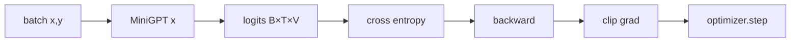

> 上一章 [实现解码器 Transformer](/ai/01-models/02/07/) 让网络能对每个位置输出词表分数;本章把它变成「会学习」的程序。动手前先弄清两件事——**一次参数更新的顺序为什么不能颠倒**、**checkpoint 为什么不只是权重**;最后合成一个可中断、可恢复、可比较的最小训练循环,并学会看曲线做第一层判断。

**学习目标**:学完本章,你将能够——

1. 复述一次参数更新的固定动作顺序,并解释颠倒每一步会破坏什么;
2. 对 `[B,T,V]` logits 和 `[B,T]` 标签正确计算 next-token 损失;
3. 实现训练、验证、梯度裁剪和定期日志的最小完整训练循环;
4. 区分「推理权重」与「训练 checkpoint」,保存足以恢复训练的现场;
5. 用训练/验证曲线识别最基本的训练异常。
## 1. 一次参数更新:顺序为什么不能颠倒

- **概念**:一次参数更新(一个 step)是训练的原子动作:取一批数据 → 前向算出每个位置的预测 → 与真实下一个 token 比出损失 → 反向传播得到每个参数的梯度 → 更新参数。预训练就是把这一动作重复几千到几十亿次,直到模型学会「根据前文预测下一个 token」。每一步都消费上一步的产物,顺序本质是**数据依赖**;颠倒不是风格问题,而是正确性问题。
- **为什么前向必须先于反向、`zero_grad` 必须先于 `backward`**:反向传播求的是「**当前参数**下 loss 对参数的梯度」,先更新参数等于拿旧梯度或空梯度改模型,loss 不会下降;PyTorch 的梯度默认**累加**,`zero_grad` 不清空会把上一步的梯度混进本次更新,方向被污染。
- **为什么裁剪必须先于 `step`、优化器放在最后**:裁剪限制的是「即将用于更新」的梯度范数,先 step 再裁剪,爆炸梯度已经落进参数,裁剪失去意义;优化器不知道你的业务目标,只按已算好的梯度把参数挪一小步。

对语言模型,交叉熵沿词表维比较预测和正确 id。`F.cross_entropy` 的类别维约定在第 2 维,最不易误用的写法是先展平:

```python
import torch.nn.functional as F

logits = model(x)                       # [B, T, V]
loss = F.cross_entropy(logits.flatten(0, 1), y.flatten())
```

- **合理性检查**:随机初始化的模型,loss 通常接近 `ln(vocab_size)`——相当于对每个词均匀瞎猜的熵。这只证明前向传播形状正确,**不能**作为「训练成功」的判定;真正要看验证 loss 是否随时间改善,以及生成结果是否改善。
## 2. 最小但完整的训练循环

- **概念**:训练循环(training loop)是反复执行「取数据 → 更新参数 → 记录状态」的驱动程序。一次 step 的改进微不足道,只有循环才能把改进累积成「学会」;循环还要顺带完成两件容易被忽略的事——**周期验证**(在未参与更新的数据上测 loss,判断是否真在泛化)与**可见性**(定期打印 loss、梯度范数,让训练可观察、可排障)。
- **为什么设备、超参、种子要写进代码**:训练结果必须可复现,依赖「机器当前状态」会让同一份代码在不同环境跑出不同曲线;以下代码省略 AMP,先保证 CPU/GPU 都能清楚运行。
```python
import random
import numpy as np
import torch
from torch import nn

def set_seed(seed: int) -> None:
    random.seed(seed)
    np.random.seed(seed)
    torch.manual_seed(seed)
    if torch.cuda.is_available():
        torch.cuda.manual_seed_all(seed)

def evaluate(model: nn.Module, loader, device: str, max_batches=20) -> float:
    model.eval()
    losses = []
    with torch.no_grad():
        for batch_index, (x, y) in enumerate(loader):
            if batch_index >= max_batches:
                break
            logits = model(x.to(device))
            losses.append(F.cross_entropy(logits.flatten(0, 1), y.to(device).flatten()).item())
    model.train()
    return sum(losses) / len(losses)

set_seed(42)
model = model.to(device)
optimizer = torch.optim.AdamW(model.parameters(), lr=3e-4, weight_decay=0.01)
for step, (x, y) in enumerate(train_loader, start=1):
    x, y = x.to(device), y.to(device)
    optimizer.zero_grad(set_to_none=True)
    logits = model(x)
    loss = F.cross_entropy(logits.flatten(0, 1), y.flatten())
    loss.backward()
    grad_norm = torch.nn.utils.clip_grad_norm_(model.parameters(), max_norm=1.0)
    optimizer.step()
    if step % 100 == 0:
        print({"step": step, "train_loss": loss.item(), "grad_norm": float(grad_norm)})
```

- `model.train()` 与 `model.eval()` 会切换 dropout、BatchNorm 等模块行为。虽然本章的 Mini GPT 可以暂不加 dropout,仍应养成验证时 `eval()` + `torch.no_grad()` 的习惯:前者关掉随机行为,后者不建计算图、省显存,保证验证 loss 不含「训练才有的随机性」。
## 3. checkpoint:为什么不只是权重

- **概念**:checkpoint 是训练中定期保存的「现场快照」。预训练动辄数天到数月,一次断电、超时或 OOM 就从头重跑是不可接受的;checkpoint 让训练能从任意中断点继续,也用于实验对比与事故回滚。只存 `model.state_dict()` 是「推理权重」,能生成文字却**不能精确续训**——续训还需要优化器状态、step、配置与随机数状态;不要把未知来源的 `.pt` 交给 `torch.load`(反序列化有安全风险),应使用 `weights_only=True`。

| 该存什么 | 作用 | 只存权重会怎样 |
|---|---|---|
| 模型权重 | 当前学到的参数 | 够推理,但不足以续训 |
| 优化器状态 | AdamW 的动量与二阶矩,即「历史梯度的记忆」 | 续训时优化器失忆,曲线出现断崖,与原训练不等价 |
| step 计数 | 对齐日志与学习率计划 | 不知道从哪一步继续 |
| config 与 tokenizer 路径 | 复现模型结构与数据流 | 换环境无法重建同一模型 |
| 随机数状态(最稳妥) | 续训后的数据顺序可复现 | 无法严格复现后续曲线 |
```python
from pathlib import Path
import torch

def save_checkpoint(path, model, optimizer, step, config):
    Path(path).parent.mkdir(parents=True, exist_ok=True)
    torch.save({
        "model_state": model.state_dict(),
        "optimizer_state": optimizer.state_dict(),
        "step": step,
        "config": config,
    }, path)

def load_checkpoint(path, model, optimizer, device):
    checkpoint = torch.load(path, map_location=device, weights_only=True)
    model.load_state_dict(checkpoint["model_state"])
    optimizer.load_state_dict(checkpoint["optimizer_state"])
    return checkpoint["step"], checkpoint["config"]
```

- **保存节奏**:每隔固定 step 保存 `checkpoints/step-000500.pt`(流水线历史),另维护一份 `best-valid.pt`,仅在验证 loss 创新低时覆盖。**绝不能用 test loss 挑选 best checkpoint**:测试集一旦参与选择就不再干净,只能留给最终一次报告。
### 3.1 把碎片合成可运行的训练程序

创建 `src/train.py`。以下是最小完整版本,依赖上一章的 `src/data.py` 与 `src/model.py`;在**项目根目录**运行,不能在 `src` 目录内运行。

```python
import csv, random
from pathlib import Path
import numpy as np
import torch
import torch.nn.functional as F
import yaml
from tokenizers import Tokenizer
from torch.utils.data import DataLoader
from src.data import NextTokenDataset
from src.model import MiniGPT

cfg = yaml.safe_load(Path("configs/minigpt.yaml").read_text())
random.seed(cfg["seed"]); np.random.seed(cfg["seed"]); torch.manual_seed(cfg["seed"])
device = "cuda" if torch.cuda.is_available() else "cpu"
m, t = cfg["model"], cfg["training"]
tokenizer = Tokenizer.from_file(cfg["tokenizer_path"])
train_ids = torch.load("data/tokenized/train.pt", weights_only=True)
valid_ids = torch.load("data/tokenized/valid.pt", weights_only=True)
train_loader = DataLoader(NextTokenDataset(train_ids, m["context_length"]), batch_size=t["batch_size"], shuffle=True, drop_last=True)
valid_loader = DataLoader(NextTokenDataset(valid_ids, m["context_length"]), batch_size=t["batch_size"], shuffle=False, drop_last=True)
model = MiniGPT(tokenizer.get_vocab_size(), **m).to(device)
optimizer = torch.optim.AdamW(model.parameters(), lr=t["learning_rate"])
run_dir = Path("runs") / cfg["run_name"]
(run_dir / "checkpoints").mkdir(parents=True, exist_ok=True)
(run_dir / "config.yaml").write_text(yaml.safe_dump(cfg), encoding="utf-8")

def loss_on(loader, limit=20):
    model.eval(); values = []
    with torch.no_grad():
        for i, (x, y) in enumerate(loader):
            if i == limit: break
            logits = model(x.to(device))
            values.append(F.cross_entropy(logits.flatten(0, 1), y.to(device).flatten()).item())
    model.train()
    return sum(values) / len(values)

best = float("inf")
with (run_dir / "metrics.csv").open("w", newline="") as file:
    writer = csv.DictWriter(file, fieldnames=["step", "train_loss", "valid_loss", "grad_norm"])
    writer.writeheader()
    iterator = iter(train_loader)
    for step in range(1, t["max_steps"] + 1):
        try: x, y = next(iterator)
        except StopIteration: iterator = iter(train_loader); x, y = next(iterator)
        x, y = x.to(device), y.to(device)
        optimizer.zero_grad(set_to_none=True)
        loss = F.cross_entropy(model(x).flatten(0, 1), y.flatten())
        loss.backward()
        grad_norm = float(torch.nn.utils.clip_grad_norm_(model.parameters(), 1.0))
        optimizer.step()
        valid_loss = ""
        if step % t["eval_every"] == 0:
            valid_loss = loss_on(valid_loader)
            print(f"step={step} train={loss.item():.4f} valid={valid_loss:.4f}")
            if valid_loss < best:
                best = valid_loss
                torch.save({"model_state": model.state_dict(), "config": cfg, "step": step}, run_dir / "checkpoints/best-valid.pt")
        writer.writerow({"step": step, "train_loss": loss.item(), "valid_loss": valid_loss, "grad_norm": grad_norm})
        file.flush()
torch.save({"model_state": model.state_dict(), "config": cfg, "step": t["max_steps"]}, run_dir / "checkpoints/latest.pt")
```

运行 `python -m src.train`。第一次先将 `max_steps` 改为 `20`,确认能产生 `runs/alice-bpe-v1/metrics.csv` 和 checkpoint;通过后改回 1,000。若报 `No module named src`,说明命令不是在项目根目录运行;若 valid loader 没有 batch,先将 `batch_size` 从 16 降到 4。
### 3.2 练习恢复训练(必须亲手验证)

上面的完整版为首次运行而写。要恢复时,在创建 `optimizer` 后、进入 `for step` 前加入:

```python
resume = Path("runs") / cfg["run_name"] / "checkpoints/latest.pt"
start_step = 0
if resume.exists():
    saved = torch.load(resume, map_location=device, weights_only=True)
    model.load_state_dict(saved["model_state"])
    start_step = saved["step"]
    print("resuming from", start_step)
```

并将 `range(1, t["max_steps"] + 1)` 改为 `range(start_step + 1, t["max_steps"] + 1)`。本教程的 `latest.pt` 没有保存 optimizer state,所以这叫「模型权重恢复」,不是严格等价的训练恢复;要精确续训,请使用本节前面的 `save_checkpoint` / `load_checkpoint` 示例并将 `optimizer_state` 写入文件。运行一次 20 step 后,把 `max_steps` 改为 30 再运行;终端必须显示 `resuming from 20`。

> [!example] 动手活动 1:完成一次可恢复训练
>
> **目标**:创建 `src/train.py`,交付一个 checkpoint、`reports/train.csv` 和一张损失曲线或表格。
>
> **步骤**:1)运行至少 300 个 step(数据不足可循环 loader,并如实记录);2)每 50 step 写入 train loss,每 100 step 写入 valid loss;3)保存最新和最佳 checkpoint;4)新启动进程加载最新 checkpoint,再训练 10 step。
>
> **完成标准**:恢复后的 step 从已保存值继续;验证过程不计算梯度;报告中能看到 step、train loss、valid loss、学习率和 grad norm,且说明最佳 checkpoint 的选择依据。
## 4. 看曲线作出第一层判断

| 现象 | 常见含义 | 先检查什么 |
|---|---|---|
| train/valid 都下降 | 正在学习 | 继续到预定预算 |
| train 降、valid 上升 | 过拟合或验证泄漏检查不足 | 停止选择、检查数据切分 |
| loss 为 NaN | 数值不稳定 | 学习率、数据 id、梯度 norm |
| 两者几乎不变 | 未学习 | 标签右移、参数是否更新、学习率 |
| valid 明显低于 train | 训练含 dropout 或数据分布差异 | 确保 eval 模式并审计数据 |

「loss 下降」不等于模型通用,也不等于没有记忆训练数据。下一章会用固定提示词和保留样本做定性检查;后续评测章节会建立更严谨指标。
## 5. 总结

本章的最小可复现实验应包含:配置、固定 seed、日志、训练/验证损失、最新 checkpoint 与最佳验证 checkpoint。它们共同回答四个问题:用了什么设置、模型是否更新、是否泛化变好、能否从中断处继续。

思考题:为何保存 optimizer state 对续训很重要?为什么最后报告不能只贴最低 train loss?

> [!note] 参考答案
> AdamW 等优化器保存了动量和二阶统计量,丢失后续训轨迹会改变。最低 train loss 只能说明拟合训练数据;应报告选择规则和从未参与选择的测试结果(如果有)。
## 引用

- [PyTorch:保存与加载模型](https://pytorch.org/tutorials/beginner/saving_loading_models.html)
- [PyTorch:可复现性说明](https://docs.pytorch.org/docs/stable/notes/randomness.html)
- [PyTorch:`cross_entropy`](https://docs.pytorch.org/docs/stable/generated/torch.nn.functional.cross_entropy.html)

上一篇:[实现解码器 Transformer](/ai/01-models/02/07/)——网络已经能对每个位置输出词表分数,本章让它开始学习。

下一篇:[采样与定性评测](/ai/01-models/02/09/)——接下来把 checkpoint 变成文字,并以固定方法检查生成质量。
