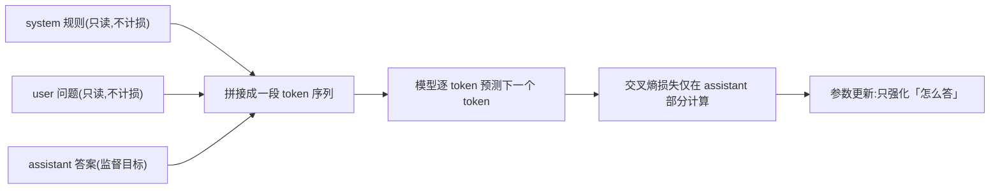

> 上一章冻结了基线——「改前成绩」;本章制作决定「模型会变成什么」的训练材料:一份结构正确、事实可核查、可审计的小型指令数据集。动手前先弄清三件事:**监督微调到底在练什么、样本的 role/content 结构为什么如此严格、为什么不能拿模型批量造答案直接训练**。读完你会交付 train/valid 两份数据与一张数据卡。

**学习目标**:学完本章,你将能够——

1. 解释「监督微调是预测下一 token 的练习」,并说明损失只算在答案上意味着什么;
2. 说出 system/user/assistant 三种 role 的分工,写出符合 schema 的 chat 样本;
3. 说明 30 条数据为何「少也能开始、但不能乱开始」,以及 train/valid 必须分离的原因;
4. 解释为什么不能拿模型批量生成的未审核答案直接训练;
5. 用加载脚本验证 JSON 合法性并交付数据卡。

## 1. 概念:微调是「预测下一 token」的练习,不是记忆问答

- 沿用 01.02 的定义:语言模型是一个「下一 token 预测器」——读到一段文字后给每个候选 token 打分,不断重复该动作就生成一句话。**预训练与监督微调共用同一个目标函数**(对下一个 token 的交叉熵损失),区别只在喂进去的数据与损失的计算范围。
- **预训练**:喂海量原始文本,对几乎每个位置都算损失,学到语言能力与通用知识;
- **监督微调(SFT)**:喂「对话样本」,但损失**只在 assistant 答案的 token 上计算**,system 与 user 部分只作为上下文被读取、不承担损失——这就是「只学怎么答,不学怎么问」。

| 阶段 | 输入数据 | 损失范围 | 模型学到的 |
|---|---|---|---|
| 预训练 | 海量互联网文本 | 全文几乎每个 token | 语言、知识、续写能力 |
| 监督微调 | 少量对话样本 | 仅 assistant 答案 | 听话的方式:格式、语气、边界 |
| 推理(无训练) | 用户消息 | 无 | 按学到的倾向采样输出 |

一条对话样本进入训练时,内部发生的事如下(system 与 user 只作为上文被读取,损失集中在答案上):



- 两个直接推论:
  1. 损失逐 token 施加在整个答案上,所以答案的**结构、语气、错误都会被同等学走**——审核数据就是在设定质量上限;
  2. 模型不会像数据库那样保存「问题 → 答案」键值对,它只调整参数,让相似输入更倾向产生相似表达。因此错误答案、互相矛盾的规则、隐私文本也会被忠实学习,**训练前审核远比训练后补救便宜**。
- 呼应上一章:基线回答「模型原本怎么答」,数据决定「往哪个方向改」,两者缺一不可——这正是本章先讲清概念再动手的原因。

## 2. 样本 schema:role 与 content 各司其职

一条 chat 样本是一个 `messages` 数组,数组里每条消息由 **role(角色)** 与 **content(内容)** 两个字段构成:

- **system**:长期身份与行为边界,如「你是课程助教,没有依据时拒答」。它像一份全程有效的规则书,**不要每条写互相矛盾的规则**,模型会无所适从;
- **user**:提出任务并提供必要上下文。**别把答案写进问题**——模型会学到「复读问题」而不是回答问题;
- **assistant**:期望回答,是整条样本唯一被监督的部分。**最后一条必须是 assistant**,否则没有可供预测的目标;
- 模型端到端看到的不是 JSON,而是 tokenizer 依据 chat template 生成的 token 序列(用特殊标记包裹各 role)。转换细节留到下一章验证,本章要做的只是保证 schema 干净——**脏数据会在转换时静默地变成脏训练信号**。

| 数据元素 | 作用 | 常见初学错误 |
|---|---|---|
| system | 固定身份与行为边界 | 每条写互相矛盾的规则 |
| user | 提供任务与必要上下文 | 把答案也写进问题 |
| assistant | 监督目标(唯一算损失的部分) | 最后一条不是 assistant |
| train/valid | 学习 / 检查泛化 | 同一题换词后分到两边 |
| content | 消息正文纯文本 | 手写 `<|im_start|>` 之类角色标记 |
| messages | 顶层数组结构 | 对象内部换行,破坏逐行加载 |

## 3. 为什么「数据量少但规则严」:30 条样本的定位

- 30 条 train + 10 条 valid **不足以**把模型变成数据库专家,却**足以**验证一条训练管线是否跑通,也**足以**让模型过拟合——这正是本单元要的:追求**可检查的行为变化**(格式更稳定、遇到资料外问题会拒答),而不是造一个新专家。
- 因此规则必须严:每条样本都应人工勾选四项——**问题明确、答案可核查、格式一致、无私密信息**。「可核查」指答案能回指到允许的课程材料,或明确表达拒答。
- 刻意包含**失败边界样本**(boundary samples):如「明天东京的天气?」这类资料外问题配上拒答回答。模型要学会「说不知道」,靠的正是这类样本——数量不必多,但必须有。
- **一次只改一个规则**:想改善格式就只动格式相关样本,想教拒答就只加边界样本;否则训练结果的变化无法归因于具体的数据改动。
- 不要把所有类型(百科问答、闲聊、翻译、敏感文本)混进一个没有标签的数据文件,质量参差会互相污染。研究也支持这一取向:LIMA 实验显示约 1 000 条精心挑选的样本即可带来显著的对齐效果——**少量可信、覆盖失败边界的样本,胜过大量来源不明的问答**。

## 4. 为什么不能拿模型批量造答案直接训练

「用模型生成大量问题—答案,再直接拿去训练」看似省力,却是初学者最常见的陷阱,原因有三:

1. **模型输出不是 ground truth**:模型的答案是它自己的预测,未经事实核验。把它当标准答案喂回去,等于让模型给自己的作业打分——自信的幻觉会被当成正确知识学走,训练后模型只会**更流畅地说错**;
2. **错误被放大而非纠正**:用自己的输出训练自己,等于把采样偏差与错误再投喂一遍(文献中称自耗循环 self-consuming loop / 模型自噬)。没有外部正确信号介入,误差只会逐代累积,不会消失;
3. **审核缺失即违规风险**:批量生成绕过了许可与隐私检查——生成内容可能携带训练数据痕迹,也可能无意编造出含个人信息的内容,而后者恰恰是本章规则明令禁止进入数据集的。

什么时候可以借助模型输出?有两条受控路线:**知识蒸馏**——用更强的教师模型生成候选答案,但每条仍需人工审核、能回指来源并符合许可;或**数据增强后的人工抽查**。要点是:模型输出只能当「草稿候选」,不能当「标准答案」;审核与可回指来源不可跳过。这也呼应 01.02 讲过的数据许可纪律。

## 5. 动手:先写规则,再写样本

课程助教的三条规则(先写规则、再写样本,每条样本只训练一个清晰行为):

- 答案只能依据允许的课程材料;
- 无法依据时明确拒答,不编造;
- 不收集真实学员姓名、电话、客户数据。

**不要**用模型批量生成「看起来很多」的答案后直接训练(原因见第 4 章)。创建 `finetune/data/train.jsonl`,**每行一个 JSON 对象,对象内部不能换行**:

```json
{"messages":[{"role":"system","content":"你是课程助教。仅依据课程内容回答；没有依据时说不知道。"},{"role":"user","content":"什么是主键？"},{"role":"assistant","content":"主键是用于唯一标识表中每一行的一列或一组列。它的值不能重复，也不能为 NULL。"}]}
{"messages":[{"role":"system","content":"你是课程助教。仅依据课程内容回答；没有依据时说不知道。"},{"role":"user","content":"明天东京的天气？"},{"role":"assistant","content":"我不知道；课程资料没有提供实时天气信息。"}]}
```

自己写至少 30 条 train、10 条 valid(valid 放在 `finetune/data/valid.jsonl`)。每条都按「问题明确、答案可核查、格式一致、无私密信息」四项人工勾选;**训练与验证不得只是同一道题的换词版本**(否则 valid 形同虚设,理由见第 2 章 schema 表)。

## 6. 动手:加载前先验证 JSON

创建 `finetune/src/check_data.py`:

```python
import json
from pathlib import Path
for split in ["train", "valid"]:
    rows = [json.loads(x) for x in Path(f"finetune/data/{split}.jsonl").read_text().splitlines() if x]
    assert rows and all([m["role"] for r in rows for m in r["messages"]])
    assert all(r["messages"][-1]["role"] == "assistant" for r in rows)
    print(split, len(rows), rows[0]["messages"][-1]["content"])
```

运行 `python -m finetune.src.check_data`;任何 `JSONDecodeError` 都表示该行不是合法 JSON,应**定位行号修复,不能删除整份数据重来**——删数据会把「该修的问题」一起删掉。两条 assert 分别检查:每条消息都有 role;每条样本最后一条是 assistant,正是第 2 章强调的 schema 铁律。

> [!example] 动手活动:交付数据卡
> **目标**:`finetune/data/train.jsonl`、`valid.jsonl` 与 `finetune/reports/data-card.md`。**步骤**:列出资料来源、作者、数量、许可、拒答样本数和人工审核人;随机阅读各 5 条。**完成标准**:脚本通过;每个答案能回指到允许材料或明确拒答;报告说明哪些问题不应由模型回答。

## 7. 总结

| 关键判断 | 一句话 |
|---|---|
| SFT 在练什么 | 预测下一 token;损失只算在 assistant 答案上,结构、语气、错误都会被学走 |
| role/content | system 定边界,user 提问,assistant 是唯一被监督的目标;最后一条必须是 assistant |
| 数据量少但规则严 | 30 条足够验证管线并暴露过拟合;每条可勾选、可回指、覆盖失败边界 |
| 为什么不能自产自销 | 模型输出未经核验,直接训练会放大自身错误;输出只能当草稿候选 |
| 验证手段 | 加载脚本查 JSON 与 schema;train/valid 分离;数据卡记录来源与审核 |

**思考题**:为什么每条样本的最后一条消息必须是 `assistant`?为什么「同一道题换词」放进 valid 会让验证失去意义?

> [!note] 参考答案
> 监督损失只施加在最后的 assistant 回答上;若最后一条是 user,就没有可预测的目标,该样本等于作废。而「同题换词」意味着模型在训练中已见过同一问题的近似答案,valid 通过只能说明它背住了题,不能证明泛化——valid 的作用正是充当「没背过题」的考场。

## 引用

- [Hugging Face:聊天模板](https://huggingface.co/docs/transformers/main/en/chat_templating)
- [Hugging Face Datasets](https://huggingface.co/docs/datasets/index)
- [LIMA:Less Is More for Alignment](https://arxiv.org/abs/2305.11206)

上一篇:[微调策略与基线](/ai/01-models/03/01/)——先想清楚何时该微调并冻结基线;本章把「想改善什么」写成可审核的训练样本。

下一篇:[Hugging Face 训练栈](/ai/01-models/03/03/)——加载数据与模型,先跑通不训练的训练栈。
