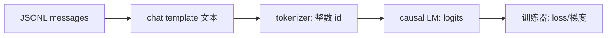

> 上一章交付了人能读的 JSONL 对话数据,本章把 Hugging Face 训练栈(Datasets、Tokenizers、Transformers、Trainer)逐层接通,证明「JSONL → chat template 文本 → token id → 模型」这条管线是通的。本章不训练模型,但这个检查能避免后续花数小时训练错误格式。

**学习目标**:学完本章,你将能够——

1. 说出 Datasets、Tokenizers、Transformers、PEFT、TRL 各自解决什么问题;
2. 解释为什么用 Trainer 而不是手写训练循环;
3. 用 `AutoTokenizer` 和 `AutoModelForCausalLM` 加载同一个模型;
4. 将 JSONL chat 数据渲染成模型实际看到的文本,并说明 chat template 的作用;
5. 检查 pad token、token 长度和角色结构是否合理;
6. 输出一份可复现的训练环境检查报告。

## 0. 本章为什么存在

上一章产出的是人能读的 JSON;模型只能处理特定 tokenizer 产生的数字。Hugging Face 训练栈负责连接两者,并按照该模型**原本的对话格式**组织数据。若此处接错,后面的 loss、checkpoint 都会是「错误输入上的正确计算」——loss 照样下降,模型却什么都没学会。本章先不训练,专门用可见的文本和 token 数证明这条管线是通的。

## 1. 先理解:一条中文问答如何变成训练数字

计算机不能直接计算汉字或角色名。tokenizer 先按模型训练时相同的规则把对话模板转换为 token id;模型把每个 id 查成向量,经过多层 Transformer 后给词表中每个候选 token 一个分数;训练器据此计算「正确答案 token 的分数够不够高」,再更新参数。任何一环错位,loss 即使下降也没有意义。



### 1.1 chat template 的作用:模型的「对话排版协议」

chat template 是不同模型约定的对话排版方式——如何标记 user/assistant 的边界、system prompt 放哪里、用哪个特殊 token 收尾。它**不是美观问题**:Qwen 是用自家模板训练过的,若换成随手拼接的 `问:…答:…`,输入分布会偏离模型已学会的格式,模型学得慢,还容易学错对话边界。

- 模板属于模型,不属于你:模板作为 Jinja2 代码随 tokenizer 发布(存于 `tokenizer_config.json`),`apply_chat_template()` 保证任何调用方都用同一份排版;
- 训练与推理的差别在一个参数:`add_generation_prompt=False` 用于训练——样本已含完整 assistant 回答,模板渲染到底;推理时才用 `True`——在用户消息后打开 assistant 作答位置,由模型自己开口。两处不一致,等于「学一套、考另一套」。

## 2. Hugging Face 生态:五个库各解决什么问题

微调不是「一个库」的事。Hugging Face 把训练栈拆成分层组件,每个库解决一个具体问题;用它们不只是省代码,而是复用经过大量项目验证的实现。

| 库 | 解决什么问题 | 关键产物 | 不用它会怎样 |
|---|---|---|---|
| Datasets | 统一加载与变换大数据 | 内存映射缓存、`.map()`、切分 | 自写解析与缓存,易踩内存坑 |
| Tokenizers | 文本 → id 的速度与一致性 | Rust 快速分词器 | 分词慢;词表不配套则 id 错位 |
| Transformers | 模型/tokenizer 加载与训练 | `AutoModel*`、Trainer | 手写架构加载与训练循环 |
| PEFT | 参数高效微调 | LoRA 等 adapter | 全参微调,显存/存储成本高 |
| TRL | 对齐阶段的标准流程 | SFTTrainer、DPO | 自己拼对齐训练,易出错 |

- 本章用到:Datasets、Tokenizer(经 `AutoTokenizer`)与 Transformers + Trainer;
- 后续用到:PEFT(第 5、6 章)、TRL(第 4、7 章)——现在先记住分工。
- **不要把上一阶段自己训练的 `tokenizer.json` 用在 Qwen 上**:开源模型的 embedding 权重已经和它自己的 tokenizer 绑定,替换会使 id 含义错位,模型输出立刻变成乱码。

## 3. 全参数微调 vs 高效参数微调(PEFT)对照

训练栈里的 Trainer 解决「怎么训」,而「训哪些参数」是更早的决策,直接决定显存与存储预算:

| 维度 | 全参数微调 | PEFT(以 LoRA 为例) |
|---|---|---|
| 更新对象 | 全部权重 | 冻结基座,只训小 adapter |
| 显存需求 | 需存全部梯度与优化器状态 | 只存 adapter 状态,可更低 |
| 存储 | 每个任务一份完整权重 | 一个基座 + 几 MB adapter |
| 适用 | 数据充足、要学全新能力 | 行为/格式适配、显存有限 |
| 风险 | 过拟合、灾难性遗忘 | 秩不足时容量有限 |

第 4 章先在全参数下看清 loss 行为,第 5、6 章再用 PEFT 在有限显存上完成真正微调——本章只需带着这张对照表理解各库的分工。

## 4. 为什么用 Trainer,而不是手写训练循环

「训练 = for 循环里前向 + 反向 + step」听起来简单,真正要写对的细节很多:设备与混合精度、梯度清零与累积、scheduler 步进顺序、`model.train()/eval()` 切换、检查点保存与恢复、日志与评测循环、多卡并行。每一处都是静默出错的温床:

| 手写循环常见错误 | 后果 |
|---|---|
| 忘了 `optimizer.zero_grad()` | 梯度跨 batch 累加,loss 异常波动 |
| 忘记切换 `train()/eval()` | dropout 行为错乱,评测失真 |
| labels 与 input 错位 | 模型学「预测自己」而非下一个 token |
| 精度/设备处理不当 | 显存爆炸,或慢到无法训练 |
| 自造检查点逻辑 | 中断无法续训,实验不可复现 |

Trainer 把这些打包成「配置驱动」组件:声明 `TrainingArguments`,传入 model、tokenizer、dataset,循环与配套工程由库内统一实现,并天然兼容 Datasets 的数据列、加速器与 Hub 上传。**这不等于可以不懂**:你仍需理解 loss、epoch、batch 这些概念(下一章),否则报错时连定位都无从下手。

## 5. 四个组件各自负责什么

| 组件 | 输入 | 输出 | 本章必须检查 |
|---|---|---|---|
| Dataset | JSONL 样本 | `messages` | 最后一轮必须是 assistant |
| Tokenizer | chat 文本 | token id | 使用基座模型自带 tokenizer |
| Model | token id | 下一个 token logits | 与 tokenizer 同一 `model_id` |
| Trainer | batch 与 labels | 参数更新 | 下一章才启用 |

## 6. 动手:创建完整的 smoke-test 脚本

创建 `finetune/src/inspect_stack.py`,复制如下内容:

```python
from pathlib import Path
from datasets import load_dataset
from transformers import AutoModelForCausalLM, AutoTokenizer

MODEL_ID = "Qwen/Qwen2.5-0.5B-Instruct"
data = load_dataset("json", data_files={
    "train": "finetune/data/train.jsonl",
    "validation": "finetune/data/valid.jsonl",
})
tokenizer = AutoTokenizer.from_pretrained(MODEL_ID)
if tokenizer.pad_token is None:
    tokenizer.pad_token = tokenizer.eos_token

def render(example):
    return {"text": tokenizer.apply_chat_template(
        example["messages"], tokenize=False, add_generation_prompt=False
    )}

rendered = data.map(render)
sample = rendered["train"][0]["text"]
ids = tokenizer(sample, truncation=True, max_length=512)["input_ids"]
print("train/valid:", len(rendered["train"]), len(rendered["validation"]))
print("pad/eos:", tokenizer.pad_token_id, tokenizer.eos_token_id)
print("token count:", len(ids))
print("rendered sample:\n", sample)
model = AutoModelForCausalLM.from_pretrained(MODEL_ID)
print("model vocab:", model.config.vocab_size, "tokenizer vocab:", len(tokenizer))
Path("finetune/reports/stack-check.txt").write_text(sample, encoding="utf-8")
```

在项目根目录运行:

```bash
python -m finetune.src.inspect_stack
```

预期:输出 train/valid 数量、非空 token 数、相同的模型/词表大小,并生成 `stack-check.txt`。打开该文件,肉眼确认 system、user、assistant 三个角色和回答文字都存在。若只看到用户问题,说明 JSONL 的 assistant 消息格式有误,必须回到上一章修数据。

## 7. 长度与模板的两个陷阱

`max_length=512` 是这次小练习的上限。报告每条样本的 token 长度;被截断时,长答案尾部可能被丢弃。不要默默把上限调得很大,先确认显存能承担 `batch_size × length`。

`add_generation_prompt=False` 用于训练,因为样本已经有 assistant 答案;推理时才用 `True`,让模板在用户消息后打开 assistant 回答位置。训练与推理模板不同,会让模型学到错误的对话边界。

> [!example] 动手活动:训练前接线验收
>
> **目标**:提交 `finetune/reports/stack-check.txt` 和 `stack-check.md`。
>
> **步骤**:运行脚本;随机检查 train 的 3 条和 valid 的 2 条渲染文本;记录最长 token 数、pad/eos id、模型 ID 和 `transformers` 版本。
>
> **完成标准**:每条均有完整 assistant 答案;没有 `<unk>`、空文本或把验证数据加载为训练数据;学生能解释为什么 tokenizer 必须随模型加载。

## 8. 总结与排错

| 现象 | 原因与处理 |
|---|---|
| `KeyError: chat_template` | tokenizer 未提供模板或版本不支持;不要自己猜格式,应按模型卡或明确模板补好后抽查 |
| `CUDA out of memory` | 本章可先用 CPU 检查格式;格式正确后才考虑下一章的 GPU 训练 |
| 渲染文本只见 user、不见 assistant | JSONL 结构有误,回到第 2 章修数据 |

**思考题**:为什么训练时用 `add_generation_prompt=False`、推理时用 `True`?若把上一阶段自训分词器用在 Qwen 上,loss 会怎样表现?

> [!note] 参考答案
> 训练样本已含完整回答,模板需渲染到底;推理时回答要由模型生成,模板只开到 assistant 作答位置。词表不匹配会让同一 id 对应不同 token,embedding 与输出层全部错位——loss 看似在下降,生成的却是乱码。

## 引用

- [Hugging Face:聊天模板](https://huggingface.co/docs/transformers/main/en/chat_templating)
- [Hugging Face:加载模型](https://huggingface.co/docs/transformers/main/en/models)
- [Hugging Face:Datasets JSON 加载](https://huggingface.co/docs/datasets/loading#json)

上一篇:[指令数据集设计](/iopanda-blog/ai/01-models/03/02/)——数据已经可以被机器验证。

下一篇:[监督微调 SFT](/iopanda-blog/ai/01-models/03/04/)——在正确模板上完成第一次监督微调。
