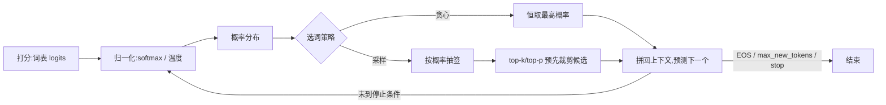

> 上一章回答「模型跑多快」,本章回答「模型说什么」。同一个模型面对同一个问题,回答可以每次一模一样,也可以每次不同——差别不在权重,而在生成时怎样从概率分布里**挑选下一个 token**。没有明确控制,用户得到的结果不可复现,模型还可能无限输出。本章把「随机性」变成有记录、可选择的接口参数:先走通 logits→概率→采样的完整流程,再逐个掌握 temperature、top-k/top-p、max_new_tokens 与 stop,最后以固定题目比较两套配置,为课程问答接口定下可复现的生成参数。

**学习目标**:学完本章,你将能够——

1. 复述 logits→概率→采样的链路,说出每一步由谁决定;
2. 用数学直觉解释 temperature 为何通过「除以温度」改变分布陡峭度;
3. 对比 top-k 与 top-p 的机制差异,说明各自在控制什么风险;
4. 比较贪心解码与随机采样,理解 seed 对可复现性的作用;
5. 按任务性质(确定性 vs 创意)选择起步参数,并设置长度上限与停止条件;
6. 判断哪些问题调参可解、哪些问题调参也救不回来。

## 1. 概念:从分数到文字

### 1.1 logits→概率→采样:一次生成的完整链路

模型每生成一步只做三件事:**打分 → 归一化 → 选词**。

- **打分(logits)**:解码器最后一层为词表上每一个候选 token 输出一个未归一化的分数,叫 **logit**。它可正可负、没有上界,数值由模型权重决定——权重来自训练,此刻冻结,接口调不了。
- **归一化(softmax)**:把一串 logits 压成总和为 1 的概率分布,分数越高概率越大,但其余 token 仍保留非零概率——这正是「次优选择偶尔也会发生」的根源。
- **选词(采样)**:最后一步决定到底输出哪个 token。每选出一个,就拼到已有文本末尾,再对下一个位置重复「打分→归一化→选词」,直到满足停止条件,这就是自回归生成。

| 环节 | 是什么 | 由谁决定 |
|---|---|---|
| logits | 词表上未归一化的原始分数 | 模型权重(训练决定,接口调不了) |
| softmax → 概率 | 分数压缩成和为 1 的分布 | 数学变换(温度在这里介入) |
| 采样选词 | 从分布中挑一个 token | 解码参数(贪心/采样/top-k/top-p) |

- **关键认识**:解码参数只作用在最后一步「怎么选」,不触碰前面的 logits。这就是为什么调参永远改不了「模型会什么」,只能改「模型这次怎么说」。01.02 第 9 章曾从零实现过这个循环,本章换成 `model.generate` 的参数,结论一致。



### 1.2 temperature:除以温度,改变分布陡峭度

采样之前,先把每个 logit 除以温度 T,再做 softmax:

`p_i = exp(z_i / T) / Σ_j exp(z_j / T)`

- **T = 1**:分布原样,照模型学到的概率抽。
- **T < 1**(如 0.2):除以小于 1 的数等于放大分数差距,分布变得更陡峭——高概率 token 更占优,输出更确定、更保守、更少意外。
- **T > 1**(如 1.2):分数差距被压缩,分布趋平,低概率候选也有机会被选中,输出更多样,也更容易跑偏。
- **T → 0**:概率几乎全部集中到最高分那个 token,等价于贪心。

直观例子:某一步三个候选的 logits 为 2.0、1.0、0.0,不同温度下的分布:

| T | 除以 T 后的 logits | softmax 后概率(从高到低) | 效果 |
|---|---|---|---|
| 0.5 | 4.0, 2.0, 0.0 | 0.867, 0.117, 0.016 | 分布更陡:几乎只选第一名 |
| 1.0 | 2.0, 1.0, 0.0 | 0.665, 0.245, 0.090 | 原始分布 |
| 2.0 | 1.0, 0.5, 0.0 | 0.507, 0.307, 0.186 | 分布趋平:第三名机会明显上升 |

- **低温度不等于更聪明**:它只是让模型更「笃定」地押注自己原本就偏好的答案;若偏好本身是错的,只会更自信地重复错误。
- **实操要点**:只有 `do_sample=True` 时 temperature 才生效;想要稳定输出,要么用贪心,要么用低温度加固定 seed。

### 1.3 top-k 与 top-p:先裁掉明显离谱的候选

temperature 重塑分布的「形状」,top-k/top-p 负责裁剪候选「名单」——把明显不靠谱的 token 在采样前清零,避免随机性把它们抬上来。

| 参数 | 机制 | 候选集合 | 风险 |
|---|---|---|---|
| **top-k** | 只保留概率最高的前 k 个(如 50),其余概率清零后重新归一化 | 固定 k 个 | k 靠拍脑袋:分布平缓时 k 太小会误伤该留的;分布尖锐时 k 太大又放进该裁的 |
| **top-p**(nucleus 采样) | 从最高概率往下累加,保留「累计概率刚好达到 p(如 0.9)」的最小集合 | 大小随分布自适应 | 更贴合分布形状,但同样只裁候选,不补质量 |

- **何时用哪个**:候选长尾很长时(开放续写)top-p 更稳;想严格排除某类低概率 token 时 top-k 更直接。两者常与 temperature 组合成一套采样配置。
- 框架内部三者的组合顺序实现各异,不必记死;记住它们都在采样前完成即可:先重塑分布、再裁剪候选、最后抽签。

### 1.4 贪心解码 vs 随机采样

| 维度 | 贪心(`do_sample=False`) | 采样(`do_sample=True`) |
|---|---|---|
| 每步怎么选 | 恒取概率最高的 token | 按概率抽签,低概率也可能中选 |
| 可复现性 | 同 prompt 恒同输出 | 需固定 seed(`torch.manual_seed(42)`)才可复现 |
| 典型风险 | 重复、平淡、绕圈;一步选错没有回头路 | 多样但发散,可能跑题、乱码 |
| 适合任务 | 问答、抽取、翻译等「要准」的任务 | 故事、文案、头脑风暴等「要新」的任务 |

- **贪心不是「更正确」**:它只是「更确定」。若模型最确定的那个 token 就是错的(如事实性错误),贪心会把错误稳稳地写出来。
- **seed 是评测纪律**:比较两套参数前先固定 seed,才能保证差异来自参数而不是运气——与上一章做性能基线时先固定 seed 是同一纪律。

### 1.5 何时停:max_new_tokens 与 stop

理想情况下模型自己输出结束符(EOS)就停;但无人值守时不能只依赖它——模型可能迟迟不输出 EOS,陷入重复或跑题,无限续写。

| 参数 | 作用 | 不设会怎样 |
|---|---|---|
| `max_new_tokens` | 新增 token 数的硬上限,到达即截断 | 输出可能无限增长:成本失控、内容跑偏 |
| `stop`(stop strings) | 出现指定字符串立即停止 | 固定结尾格式(JSON、分隔符等)无法保证 |
| EOS 正常结束 | 模型自认答完 | 属理想情况,不能当作唯一保险 |

- 截断是**信号不是故障**:输出恰好撞到 `max_new_tokens`,先检查上限是否太小、模型是否在绕圈,不要立刻认定模型坏了。
- 线上接口永远要设上限与停止条件——这是控制成本与风险的第一道闸。

### 1.6 为什么参数不能修复质量

- 概率分布的「候选名单」由训练决定。若高概率的候选全是错的(事实错误、语病、幻觉),任何采样策略都只是**在这些错误里换一种选法**。
- 参数能改的是确定性、多样性、长度,改不了知识、事实与训练数据质量。答错就调低 temperature,只是让模型更笃定地重复错误;答错就调高 temperature,只是让它在错误里更随机地挑一个。
- 质量问题的正确出路不在解码参数:事实性靠检索(RAG)或换模型,行为风格靠微调(01.03),约束靠 system prompt——参数只负责把这些手段的结果稳定地、按需地表达出来。

## 2. 按任务选参:确定性 vs 创意

没有「万能默认参数」。动手前先回答:这个任务要的是**每次尽量一样且正确**,还是**每次尽量不同且有趣**?以此为起点查表:

| 场景 | 起步设置 | 原因 |
|---|---|---|
| 课程问答/抽取 | `do_sample=False` | 最可复现 |
| 头脑风暴 | `temperature=0.8, top_p=0.9` | 保留适度多样性 |
| 任何线上接口 | `max_new_tokens` + stop | 控制成本与跑偏 |
| 翻译/改写/代码 | `temperature=0.2` 或 `do_sample=False` | 语义要准,不允许乱发挥 |
| 客服/事实问答 | `do_sample=False` | 错误代价高,稳定优先 |
| 创意文案/故事 | `temperature=0.8~1.0, top_p=0.9` | 鼓励表达多样 |

- 表只是**起点**:换模型后要重新验证,不同模型学到的分布陡峭度不同,同一套参数表现会变。
- 两套配置对照时,固定模型、prompt、seed,让唯一变量是参数本身。
- 重复与呆板(确定性过高)和发散与乱码(随机性过高)是同一枚硬币的两面,调参是在中间找平衡点,而不是把某个数值奉为真理。

## 3. 动手:修改并比较生成配置

在 `generate.py` 的 `model.generate` 调用中依次运行(沿用其中已加载的 `model`、`tokenizer`、`ids`):

```python
cases = [
    {"name":"greedy", "do_sample":False},
    {"name":"creative", "do_sample":True, "temperature":0.8, "top_p":0.9},
]
for case in cases:
    torch.manual_seed(42)
    result = model.generate(ids, max_new_tokens=120, eos_token_id=tokenizer.eos_token_id, **{k:v for k,v in case.items() if k != "name"})
    print(case["name"], tokenizer.decode(result[0][ids.shape[1]:], skip_special_tokens=True))
```

用 5 个固定问题各跑两种设置,原样写入 `reports/generation-controls.md`。不要只挑一条漂亮结果;分别标注事实性、重复、是否按时停止和格式遵守。

> [!example] 动手活动:发布生成配置表
>
> **目标**:`generation-controls.md`。
>
> **步骤**:固定模型、prompt、seed;比较两套设置;选一套给课程问答接口;说明上限与停止条件。
>
> **完成标准**:别人可复制参数重现对比,且你能说明为何确定性问答不用高 temperature。

## 4. 总结与排错

| 参数 | 一句话作用 | 备注 |
|---|---|---|
| `temperature` | 缩放 logits,改变分布陡峭度 | <1 更确定,>1 更多样;仅采样时生效 |
| `top_k` | 只留概率最高的前 k 个候选 | 候选集合固定 |
| `top_p` | 保留累计概率达 p 的最小候选集 | 候选集合随分布自适应 |
| `max_new_tokens` | 生成长度的硬上限 | 线上接口必设 |
| `stop` | 遇到指定字符串即停 | 配合固定结尾格式 |

| 现象 | 先检查 | 处理 |
|---|---|---|
| 输出每次不一样 | 是否需要可复现 | 固定 seed,或改用 `do_sample=False` |
| `do_sample=False` 却传了 temperature/top-p | 参数是否生效 | 不会起作用,应去掉以免误导 |
| 输出被截断 | `max_new_tokens` 与 stop | 上限太小或模型绕圈;不要先怀疑模型坏了 |
| 答得自信但错误 | 分布里有没有「对」的候选 | 调参救不回,回到数据、RAG 或微调 |

**思考题**:为什么「确定性问答」不用高 temperature?对比两套参数时为什么必须固定 seed?

> [!note] 参考答案
> 高 temperature 会把分布拉平,让低概率(常是跑题、错误)的候选也有机会被选中,事实性问答承受不起这种随机性。不固定 seed 时,同一套参数两次运行结果都可能不同,你无法判断差异来自参数还是运气——固定 seed 才能让唯一变量是生成配置。

## 引用

- [Transformers:生成策略](https://huggingface.co/docs/transformers/main/en/generation_strategies)
- [Hugging Face 博客:How to generate text](https://huggingface.co/blog/how-to-generate)

上一篇:[推理基础](/ai/01-models/04/01/)——先测出模型「跑多快」,再决定让它「说什么」。

下一篇:[模型量化](/ai/01-models/04/03/)——控制行为后,比较不同数值精度下的成本与质量。
