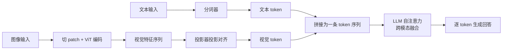

> 上一单元(01.04)结束时,你部署上线的还是一个只能读文字的模型;而真实世界发来的请求里,往往带着截图、照片和图表。本章是 01.05 Multimodal Models 的开篇:先把「多模态到底是什么、图像凭什么能被语言模型读懂、主流架构长什么样」讲清楚,再亲手加载一个开源视觉语言模型跑通第一次看图问答,并复现纯文本模型「看不见图」的边界。读完你会带着一张架构全景图进入后续四章(视觉编码器、图文数据、微调、收官项目)。

**学习目标**:学完本章,你将能够——

1. 说出多模态模型的定义,用一张对比表讲清单模态与多模态的差异;
2. 画出「输入编码 → 投影对齐 → 融合 → 生成」的核心链路,解释每个环节的职责;
3. 回答三个关键设计问题:图像怎么变成 token、视觉空间如何与文本空间对齐、视觉信息放在 LLM 的哪个位置;
4. 对比早期融合、跨模态编码器、LLM 后端融合三种架构,说明为什么最后一种成了当前主流;
5. 用 Qwen2.5-VL-3B-Instruct 跑通看图问答,并让纯文本模型在同样的题目上「翻车」,解释翻车原因。

## 1. 什么是多模态模型

- **多模态(multimodal)**指一个模型能同时处理**文本、图像、音频、视频**等多种输入,并在它们之间做联合推理;视觉语言模型(VLM)是其中最常见的一类——读图 + 说话。
- 纯文本 LLM 的输入只有一个通道:token。图像对它是「不存在的东西」;而多模态模型在文本通道之外,额外拥有把像素变成模型可读表示的通道。
- 上一单元(01.04)你部署的推理 API 只能收字符串;若用户上传一张报错截图,服务端要么拒收,要么得靠外部 OCR 先转成文字——这就是单模态的边界。本单元(01.05)的目标,就是让模型自己长出「眼睛」。

| 维度 | 单模态(纯文本 LLM) | 多模态(VLM) |
|---|---|---|
| 输入 | 只能 token 化的文字 | 文字 + 图像/音频/视频 |
| 感知来源 | 只有符号,无像素 | 像素经编码后也参与计算 |
| 典型任务 | 写作、代码、纯文本问答 | 看图问答、图表理解、截图答疑 |
| 面对一张图 | 「看不到」,只能靠人转述 | 直接「看」,但可能看错(幻觉) |
| 代表 | Qwen2.5-3B、GPT 文本模式 | Qwen2.5-VL、LLaVA、SmolVLM |

## 2. 为什么需要多模态

- **现实数据天生多模态**:课程 PPT 有图有文字、商品页有主图有参数表、技术问答常常带报错截图、会议纪要夹杂图表——只处理文本等于主动扔掉一半信息。上一单元(01.04/07)运维的线上服务,迟早要面对「带图请求」。
- **人类理解本身就是跨模态的**:你读一页书时,眼睛同时处理版式、插图与文字,大脑把它们融合成意义;「先转成文字再看」反而是人造的、有损的中间步骤。
- 不训练多模态模型,就只能走**管道拼接**:OCR 模型提取文字 → CV 模型输出标签 → 拼成一段文本喂给 LLM。这种做法有三个损失:布局与空间关系(哪段文字挨着哪张图)丢失、每级模型误差逐级放大、多轮对话中无法回头「再看一眼原图」。原生多模态模型让所有模态在共享表示里一起参与注意力,信息不经过有损的文本中转。

## 3. 核心链路:图像如何进入语言模型

多模态推理在一条链路上完成四个环节:

1. **输入编码**:文本经分词器变成 token;图像先被切成 patch(如 14×14 像素的小块),由视觉编码器(ViT)编码成一串**视觉特征**(下一章的主角);
2. **投影对齐**:视觉特征经一个轻量投影器(线性层或 MLP)映射到文本 embedding 的维度,变成模型能「接着读」的**视觉 token**;
3. **融合**:视觉 token 与文本 token 拼接成同一条序列,一起进入 LLM 的自注意力层——文本 token 通过注意力「看到」图像 token;
4. **生成**:LLM 照常逐 token 自回归生成回答。



- 关键认知:图像**不是**被「放进」模型的,而是被编码、压缩、转写成一串与文本同构的 token 序列。所以「看图」本质上是**条件文本生成**:以视觉 token 为上下文,预测接下来的文字。

## 4. 三个关键设计问题

- **问题一:图像怎么变成 token?** 图像是二维连续像素,文本是一维离散符号,两者天然不同构。通行解法是 patchify:把图像切成小块,每块经 ViT 编码成一个向量。token 数量取决于分辨率:Qwen2.5-VL 中每个视觉 token 覆盖约 28×28 像素区域,一张 560×560 的图 ≈ 20×20 = 400 个视觉 token;图越精细(小字、密集图表),需要的 token 越多。
- **问题二:视觉空间与文本空间如何对齐?** ViT 输出的特征维度和 LLM 的 embedding 维度、语义坐标系都不一样,直接拼接等于鸡同鸭讲。投影器负责「翻译」:把视觉特征线性映射到文本 embedding 空间,让两种 token 可以在同一层注意力里比较。对齐质量的高低,直接决定模型是「真看懂」还是「看着图瞎说」——这是 02 章与 04 章微调反复优化的对象。
- **问题三:视觉信息放在 LLM 的哪个位置?** 主流做法是把视觉 token 以特殊占位符(如 Qwen2.5-VL 的 `<|image_pad|>`)的形式**插入文本序列**,跟在问题附近。位置本身也是可设计参数:放最前面当「前缀」、按提问位置就近插入,效果不同。

## 5. 三种融合架构:视觉信息放在哪

按「视觉与文本在哪里汇合」,多模态模型分三代:

| 架构 | 做法 | 代表 | 得与失 |
|---|---|---|---|
| **早期融合** | 图像像素/浅层特征与文本在输入端拼接,一起进同一个网络 | 早期 VQA 模型 | 实现简单;但像素与 token 语义鸿沟大,难以端到端学到对齐 |
| **跨模态编码器** | 文本、图像各自编码(双塔),再用融合层/交叉注意力交互 | CLIP 双塔、Flamingo | 对齐质量高;但偏重「匹配/检索」,自由生成要外挂解码器 |
| **LLM 后端融合(LLaVA 式)** | 视觉 token 作为前缀拼进序列,交给现成 LLM 统一自注意力 | LLaVA、Qwen2.5-VL、SmolVLM | 复用 LLM 的推理与指令跟随能力,训练/部署工具链成熟,当前绝对主流 |

- LLaVA 式的本质是「**给 LLM 加眼睛**」:语言能力完全继承自预训练 LLM,新学的只有视觉编码器与投影器(以及后续微调)。这意味着 01.01~01.04 你学过的注意力、token 生成、LoRA 微调、vLLM 部署经验几乎全部复用——这也是本单元把它选为教学主线的根本原因。

## 6. 动手:跑通第一次看图问答

在课程工程根目录新建 `multimodal/` 目录,激活既有 `.venv` 并确认 `transformers` 为较新版本(官方要求 ≥ 4.51,建议直接用最新版),然后创建 `multimodal/src/vlm_ask.py`:

```python
# vlm_ask.py —— 看图问答:VLM 版本(Qwen2.5-VL-3B-Instruct)
import torch
from transformers import AutoProcessor, Qwen2_5_VLForConditionalGeneration

MODEL_ID = "Qwen/Qwen2.5-VL-3B-Instruct"
IMAGE, QUESTION = "assets/demo.png", "这张图里有什么?请用一句话概括。"

model = Qwen2_5_VLForConditionalGeneration.from_pretrained(
    MODEL_ID, torch_dtype=torch.bfloat16, device_map="auto")
processor = AutoProcessor.from_pretrained(MODEL_ID, min_pixels=256 * 28 * 28,
                                          max_pixels=1280 * 28 * 28)

messages = [{"role": "user", "content": [
    {"type": "image", "image": IMAGE},
    {"type": "text", "text": QUESTION},
]}]
inputs = processor.apply_chat_template(
    messages, tokenize=True, add_generation_prompt=True,
    return_dict=True, return_tensors="pt").to(model.device)

pad = processor.tokenizer.convert_tokens_to_ids("<|image_pad|>")
print("视觉 token 数量:", (inputs.input_ids == pad).sum().item())

with torch.no_grad():
    out = model.generate(**inputs, max_new_tokens=256, do_sample=False)
answer = processor.batch_decode(out[:, inputs.input_ids.shape[1]:],
                                skip_special_tokens=True)[0]
print("回答:", answer)
```

运行前准备一张本地图片放到 `multimodal/assets/demo.png`(自己的截图、照片都行),然后执行 `python -m multimodal.src.vlm_ask`。成功的话你会看到两行输出:第一行是这张图被编码成的视觉 token 数(高分辨率图数字更大),第二行是模型给出的真实回答。

- **对照实验(纯文本模型)**:把同样的题目交给纯文本模型——它没有视觉通道,消息里根本放不进图像,只能收到一句「这张图里有什么?」。常见结果是三种:坦白「我看不到图片」、凭空编造一个答案(幻觉)、或对图片字段直接报错。**这不是 bug,而是「没有视觉编码器」的直接证据**:模型根本没收到任何像素,一切「看图」都无从谈起。这也解释了为什么管道拼接(先 OCR 再问答)会丢失版面信息——它把二维世界压成了一维文字。
- **显存紧张的替代**:没有 6 GB 以上显存时,可把 `MODEL_ID` 换成 SmolVLM-256M-Instruct(权重仅数百 MB,CPU 也能跑,只是慢),加载与消息格式几乎一致,详见其模型卡。

> [!example] 动手活动：第一次看图问答
> **目标**:在 `multimodal/` 下跑通 VLM 看图问答并留下对照记录。**步骤**:准备 1~2 张本地图片(建议一张含文字、一张纯场景);运行 `vlm_ask.py` 记录视觉 token 数与回答;再把模型换成纯文本版(如 Qwen2.5-3B-Instruct,消息只留文字),记录它的三种典型反应。**完成标准**:能解释「图像被编码成多少个 token、这些 token 与文本 token 如何拼接」,并写一段话说明纯文本模型为什么必然答不出图里的内容。

## 7. 总结、边界与排错

| 关键判断 | 一句话 |
|---|---|
| 多模态的本质 | 除文本外,模型还能把像素等信号编码成可读表示并联合推理 |
| 为什么原生多模态 | 真实数据天生跨模态,管道拼接丢信息、错级联 |
| 核心链路 | 输入编码 → 投影对齐 → LLM 内融合 → 自回归生成 |
| 三个设计问题 | 图像如何 token 化、空间如何对齐、视觉 token 放哪里 |
| 主流架构 | LLaVA 式:视觉编码器 + 投影器 + 现成 LLM |

- **边界要诚实**:能看图不等于看懂了——模型仍会幻觉(图上没有的东西也敢说)、会漏看小字、会因分辨率不足把「6」看成「8」;对视频,概念上等价于按帧采样成图像 token 序列;音频则常先转写再入文本。这些限制正是 05 章收官项目要评测与记录的风险。
- 排错:显存不足优先降低 `max_pixels` 或换 SmolVLM;下载慢可配置镜像或先用 `huggingface-cli download` 预取;processor 必须与模型同目录加载,混用会报 shape 错误;输出全是占位符重复时,多半是图像没被真正编码进 `inputs`(检查是否走了含图片的 chat template)。

**思考题**:一张 560×560 的图片会产生约多少个视觉 token?这些 token 是「像素的拷贝」吗?既然纯文本模型看不到图,那「先用 OCR 转文字再问答」的管道为什么仍然不如原生多模态?

> [!note] 参考答案
> 约 400 个(每 token 覆盖 28×28 像素)。不是拷贝:它们是 ViT 编码压缩后的高层语义特征。管道方案的损失在于:OCR 只保留文字、丢掉版面与空间关系(哪段文字对应哪张图),且 OCR 的错字会直接污染下游回答,模型也没有机会「回头看图」核对——而原生多模态让视觉与文本在同一层注意力中互相对照,信息通路更短、更保真。

## 引用

- [Transformers:Qwen2.5-VL 文档](https://huggingface.co/docs/transformers/model_doc/qwen2_5_vl)
- [Qwen2.5-VL-3B-Instruct 模型卡](https://huggingface.co/Qwen/Qwen2.5-VL-3B-Instruct)
- [LLaVA:Visual Instruction Tuning](https://arxiv.org/abs/2304.08485)
- [SmolVLM-256M-Instruct 模型卡](https://huggingface.co/HuggingFaceTB/SmolVLM-256M-Instruct)

上一篇:[部署与运维](/iopanda-blog/ai/01-models/04/07/)——纯文本模型完成部署运维,本单元为它装上眼睛。

下一篇:[视觉编码器与视觉语言模型](/iopanda-blog/ai/01-models/05/02/)——看清这双眼睛的内部:CLIP 与投影器如何把图像变成模型能读的表示。
