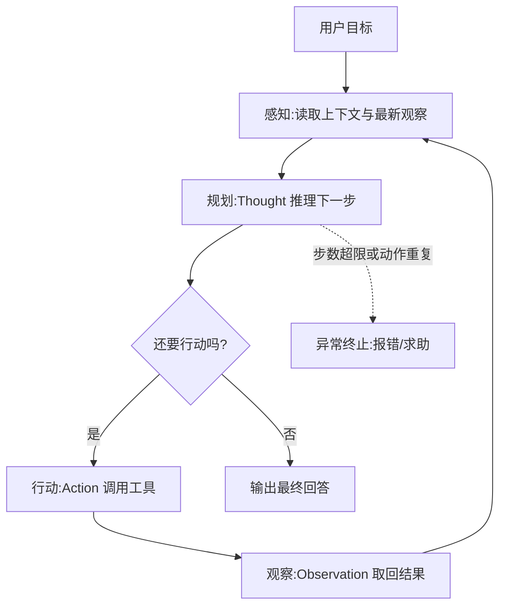

# Agent 运行循环

> 01 章给「课程助教 Agent」装上了模型、上下文、规划、工具、记忆五要素,02 章解释了它为什么在 2023 年后才成为现实。可零件摆在那里不会自己工作——是什么让它们转起来?答案是**运行循环**:一个「感知→规划→行动→观察」的闭环,也是 Agent 与「一次生成完事」的聊天机器人之间最本质的差别。本章把这个循环拆开:它怎么转、为什么必须转、什么时候停,以及为什么我们能像看回放一样检查它的每一步决策。

**学习目标**:学完本章,你将能够——

1. 说出 Agent 运行循环的四个环节,并解释每步的职责与典型失效点;
2. 用 Thought/Action/Observation 复述 ReAct 思想,并说明它与「只推理不行动」的区别;
3. 论证为什么多步任务必须循环执行,而不是让模型一次生成完整答案;
4. 写出循环的三种终止条件,并知道如何防死循环;
5. 读懂一条 Agent 轨迹,指出每一步属于「想/做/看」中的哪一种。

## 1. 概念:什么是 Agent 运行循环

- **运行循环(run loop)**:Agent 处理一个任务时反复执行的「感知→规划→行动→观察」四步闭环。每转一圈,Agent 要么离目标近一步,要么确认此路不通、换一条路。
- 用课程助教举例:学员问「外键和级联删除有什么区别」,它不是一次答完,而是先**感知**(读题:这次问了两个概念)→**规划**(决定先查资料)→**行动**(调用检索工具)→**观察**(看到资料内容)→再**规划**(组织回答)→**行动**(输出)→**观察**(确认已送达)→停止。
- 类比人:做菜要「看菜谱→下锅→尝一口→再调味」,搬家要「看清单→搬一件→核对→搬下一件」。凡是结果依赖中间反馈的任务,天然是循环结构。
- 与 01 章衔接:五要素里,模型是大脑、上下文是工作台、工具是手、记忆是便签,而**循环是让它们协作起来的工作方式**——没有循环,它们只是五件互不相干的零件。

## 2. 为什么需要:为什么循环而不是一次生成

- **信息在行动之后才出现**。回答「外键和级联删除的区别」之前,Agent 并不知道课程资料里是怎么写的——必须「查完、看到、再答」。一次生成只能赌模型肚子里恰好有正确答案。
- **后一步依赖前一步的输出**。检索到什么,决定怎么组织回答;回答得对不对,只有发出去后学员反馈才知道。这种依赖链天然需要逐步推进。
- **世界会出错、会变卦**。工具可能调用失败,检索结果可能为空,写文件可能没权限。循环让 Agent 看到失败后可以重试、换工具或向用户求助;一次生成没有第二次机会。
- **错误可以被局部化**。一次生成长答案,中间错一步就全错(错误传播);循环里每步只看当前观察,错了只重做这一步。
- 论文支撑:ReAct(Yao et al., 2022)指出,纯推理(Chain-of-Thought)是「静态黑盒」——想法不接触外部世界,容易幻觉和错误累积;把推理与行动交错,想法才能被观察持续修正。

## 3. 作用:循环在 Agent 架构中的位置

| 视角 | 循环的作用 |
|---|---|
| 对五要素 | 主轴:串起模型(每轮调用)、上下文(每轮更新)、工具(行动时调用)、记忆(轨迹即记忆) |
| 对任务 | 发动机:把「一个目标」转成「一串有反馈的步骤」 |
| 对开发者 | 观测窗:循环的每一轮都可打印、可审计、可断点续跑 |
| 对判断 | 试金石:有没有自主循环,是区分「带工具的对话」与「Agent」的关键 |

- 预告:05 章你将手写这个循环(约 50~80 行 Python),06 章你会发现 LangGraph、AutoGen 等框架本质都是这个循环的不同调度与封装。

## 4. 详细介绍:四步循环与 ReAct

### 4.1 四步拆解

| 环节 | 做什么 | 常见失效点 |
|---|---|---|
| 感知 | 读取任务、历史轨迹、最新观察,汇总成上下文 | 上下文太长被截断;漏看最新观察 |
| 规划 | 模型推理:判断现状、决定下一步(Thought) | 幻觉:没查就说「已查到」 |
| 行动 | 解析出动作并调用工具(Action) | 工具名/参数写错;动作格式解析失败 |
| 观察 | 把工具结果读回系统(Observation) | 结果太长不截断;把报错当成功 |

### 4.2 ReAct 思想:Thought → Action → Observation

- ReAct 来自论文「ReAct: Synergizing Reasoning and Acting in Language Models」(Yao et al., 2022,ICLR 2023,arXiv:2210.03629),是当今 Agent 循环的事实标准,原文格式为 `Thought/Act/Obs` 交错。
- 核心洞见:**推理与行动互相增强**——Thought 让行动有依据、能跟踪计划与处理异常;Action 让推理获得外部信息,不再凭空想。
- 与四步的对应:Thought≈规划,Action≈行动,Observation≈观察,而「感知」是循环外部对前两者的回填。

| 成分 | 含义 | 课程助教示例 |
|---|---|---|
| Thought(想) | 用自然语言写下推理:「已知什么、还差什么、下一步做什么」 | 「学员在问两个概念,资料里可能有定义,先检索」 |
| Action(做) | 一个可执行动作,通常含工具名与参数 | `检索(外键);检索(级联删除)` |
| Observation(看) | 工具返回的真实结果,喂回给下一轮 Thought | 「外键是引用另一张表主键的字段……」 |

- 与 CoT 的关键差异:CoT 是「一口气想完再答」,没有 Observation 环节;ReAct 是「想一步、做一步、看一步」,把思考钉在外部事实上,这也是它在需要查证的多跳问答(HotPotQA)与网页操作(WebShop)等任务上大幅领先的原因。

### 4.3 运行流程图与伪代码



```
while True:
    感知    更新上下文(任务 + 历史轨迹 + 最新观察)
    规划    调用模型 → Thought(推理下一步)
    决策    if 判定任务完成:输出最终回答,break
            if 步数 ≥ max_steps:提示超时,break
            if 动作与历史重复:报告死循环,break
    行动    从 Thought 解析出 Action,调用对应工具
    观察    把工具结果作为 Observation 写回上下文
    步数 += 1
```

### 4.4 循环终止条件

| 终止条件 | 触发方式 | 课程助教示例 |
|---|---|---|
| ① 任务完成 | 模型在 Thought 中宣告完成,或产出 Final Answer | 「两个概念都查到了,输出回答」→ 循环停止 |
| ② 达到最大步数 | 外部计数器上限(如 10 步),防止失控 | 学员问题太宽泛,10 轮还没查完 → 停下来问清楚 |
| ③ 检测到死循环 | 动作序列重复、连续 N 轮无进展 | 反复检索同一个词、回答永远没发出去 → 强制中断 |

- 死循环是 Agent 工程的头号事故:LLM 没有内建的「该停了」的开关,**停止的责任在循环代码,不在模型**。
- 还有一种常被忽略的合法终止:**承认失败**。查不到资料时,「向学员道歉并建议换问题」比无限重试更专业(呼应 01.07 的护栏思想)。

### 4.5 轨迹可观测性

- **轨迹(trace)**:循环从第 1 轮到终止的全部 Thought/Action/Observation 记录。它是 Agent 的「行车记录仪」。
- 为什么重要:①调试——任务失败时,回放轨迹就能定位是「想错了、做错了还是看错了」;②可解释——学员/老师能看清助教为什么这么答;③评测——05 章将用它做验收标准;④改进——把好轨迹喂回提示词,Agent 会越用越顺。
- 打印轨迹是 03 章交付物的核心:让「模型的每一步决策」从黑盒变成可检查的明文。

## 5. 动手活动:打印一条可解释的轨迹

> [!example] 动手活动:mini_react_trace.py——打印 Thought/Action/Observation 轨迹
>
> **目标**:运行下方代码(纯 Python 3、无第三方依赖),观察一个迷你课程助教循环如何完成「解释外键与级联删除的区别」,并指出每行输出属于想/做/看。
>
> **运行方式**:保存为 `mini_react_trace.py` 后执行 `python3 mini_react_trace.py`;这里的「模型」是查表伪函数,05 章将把它替换成真实 LLM API。
>
> ```python
> # mini_react_trace.py —— 课程助教最小 ReAct 循环(纯 Python 3,无依赖)
> knowledge = {   # 模拟课程资料库
>     "外键": "外键是引用另一张表主键、保证引用完整性的字段。",
>     "级联删除": "删除父表行时,自动删除子表中引用它的行。",
> }
>
> def model(context):   # 模拟模型推理;05 章将替换为真实 LLM 调用
>     for term in knowledge:
>         if term in context and knowledge[term] not in context:   # 定义还没查到才检索
>             return ("Thought:学员问「%s」,先查资料。" % term,
>                     "Action:检索(%s)" % term)
>     return ("Thought:两个概念都查清了,组织三点式回答。", "Action:回答")
>
> def tool(action):   # 模拟检索工具
>     if "检索" in action:
>         term = action[action.index("(") + 1:action.index(")")]
>         return "Observation:" + knowledge[term]
>     return "Observation:回答已发出。"
>
> context, step, past_actions = "任务:解释外键与级联删除的区别。", 0, []
> while step < 5:   # 终止条件②:最大步数
>     step += 1
>     print("— 第 %d 轮 —" % step)
>     thought, action = model(context)
>     print(thought); print(action)
>     if "回答" in action:   # 终止条件①:宣告任务完成
>         print("终止:任务完成"); break
>     if action in past_actions:   # 终止条件③:重复动作 → 死循环
>         print("终止:检测到死循环"); break
>     past_actions.append(action)
>     observation = tool(action)
>     print(observation)
>     context += "\n" + thought + "\n" + action + "\n" + observation   # 轨迹写回上下文
> else:
>     print("终止:已达最大步数")
> ```
>
> **完成标准**:能指着输出逐行说出「这是想/做/看」;能解释如果把模型里 `资料[词] not in 上下文` 这个「查过没」的判断删掉,会发生什么(提示:会触发终止条件③)。

## 6. 边界与排错

| 症状 | 原因 | 处理 |
|---|---|---|
| 循环永不停止 | 模型总认为「还差一步」 | 设 max_steps;要求模型明确宣告完成 |
| 反复做同一件事 | 观察没被写回上下文,模型看不到结果 | 检查「行动→观察→再感知」链路是否闭环 |
| 轨迹显示「查了但答案没用上」 | 上下文被截断,早期观察丢失 | 截断策略留给 02.02/02.05 展开 |
| 模型宣称工具成功但实际没调用 | 幻觉(呼应 04 章) | 由代码核实工具真实返回,不轻信模型描述 |

- 边界提醒:本章的循环是「单 Agent、顺序执行」的最简形态;多 Agent 协作(02.06)、记忆检索(02.05)都是在它之上做加法,骨架不变。

## 7. 总结

| 概念     | 一句话                                             |
| ------ | ----------------------------------------------- |
| 运行循环   | 感知→规划→行动→观察的闭环,Agent 的发动机                       |
| ReAct  | Thought(想)/Action(做)/Observation(看)交错,推理与行动互相增强 |
| 为什么循环  | 信息在行动后才出现,后步依赖前步,世界会出错                          |
| 终止条件   | 任务完成 / 最大步数 / 死循环检测(含承认失败)                      |
| 轨迹可观测性 | 每轮想/做/看都可打印回放,是调试与评测的抓手                         |

**思考题**:如果把课程助教改成「一次生成」——让模型直接输出最终答案而不经过循环,什么任务下它还能凑合?什么任务下一定会翻车?

> [!note] 参考答案
> 对「单一事实、模型已知、无需查证」的问题(如「什么是主键」),一次生成通常够用,这也是普通聊天机器人的工作方式。一旦任务需要外部信息(查学员进度)、多步依赖(查资料→出题→存文件)或处理失败(检索为空),一次生成就会暴露幻觉与错误传播——这正是循环存在的理由。判断标准:任务里有没有「做完一步才能知道下一步」的环节。

## 引用

- [arXiv:ReAct: Synergizing Reasoning and Acting in Language Models(Yao et al., 2022,ICLR 2023)](https://arxiv.org/abs/2210.03629)
- [ReAct 论文项目主页(含示例轨迹)](https://react-lm.github.io/)
- [Anthropic:Building effective agents(agentic loop 的工程化描述)](https://www.anthropic.com/research/building-effective-agents)

上一篇:[Agent 为什么现在才热](/ai/02-agents/01/03/)——知道循环怎么转之后,真正限制它转多好的是模型本身的能力边界。

下一篇:[模型能力边界如何限制 Agent](/ai/02-agents/01/05/)——模型会幻觉、窗口有限、不会说「我做不到」,这些如何约束 Agent?
